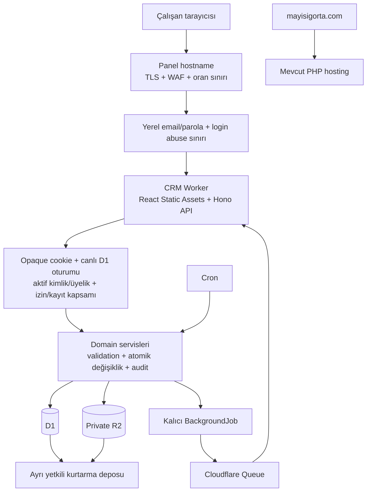

# Mayı Sigorta — Nihai mimari ve uygulama planı

**Sürüm:** 1.2 · **İlk tarih:** 16 Eylül 2026 · **F-27 güncellemesi:** 6 Ekim 2026 · **Durum:** Uygulamanın esas alınacak tasarım sözleşmesi.

**F-27 ileri yönlü auth supersession:** Tek çalışan auth yolu kapalı OWNER-provisioned email/parola + opaque D1 cookie session'dır. Aşağıdaki tarihsel Access/JWT/audience/OTP/TOTP/MFA gereksinimlerinin tamamı çalışan auth açısından SUPERSEDED'dır, tamamlanmış sayılmaz. Cloudflare administrative MFA ayrı kalır. AUTH evidence bir mimari kaynak değil uygulama kanıtıdır. M4 COMPLETE=false, DOCUMENTS_ENABLED=false, M5 başlamadı.

Kullanıcının son talimatıyla teknik ve ürün tasarımındaki açık seçenekler karara bağlandı. Personel izinlerini acente sahibi seçer. Bu belge önceki planlama paketinin ve mimari incelemesinin yerini alır; eski belgeler yürürlükte değildir. Gerçek ortam kimlikleri, hesap erişimleri ve mevzuata ilişkin teyitler mimari seçenek değil, 17. bölümde tanımlanan kurulum girdileridir. Bunların tamamlandığı varsayılmaz.

**Ürün:** Mayı Sigorta çalışanlarına “bugün hangi müşteri için ne yapmalıyım?” sorusunun cevabını veren, yenileme odaklı güvenli CRM. Yaklaşık 15.000 poliçelik başlangıç portföyü için tasarlanır. Arayüz ve kullanıcı mesajları Türkçedir.

**Güncel ürün sınırı (F-26):** Yalnız önceden yetkilendirilmiş acente çalışanları giriş yapar ve belge yükler. Müşteri, sigortalı, dış ortak, anonim veya genel Internet kullanıcısı giriş/yükleme yapmaz. Küçük mevcut ekip bir tehdit modeli gözlemidir; çalışan sayısına mimari, şema, UI veya lisans sınırı konmaz. OWNER/MEMBER, kişi izinleri, çok-kullanıcılı CAS, idempotency ve audit korunur.

**İlk 16 Eylül teslimi yalnız planlamaydı.** Gerçekleşen uygulama/altyapı kanıtı `UYGULAMA_DURUMU.md` dosyasındadır. F-26 ürün sahibinin ileri yönlü güvenlik kararıdır; bu belge tek başına kaynak oluşturma/ücretli ürün veya production deployment yetkisi vermez.

## İçindekiler ve okuma düzeni

1. Kesin karar özeti
2. V1 kapsamı ve başarı ölçütü
3. Sistem mimarisi ve teknoloji
4. Personel bazlı izinler
5. Yerel kimlik, oturum ve kritik işlem doğrulaması
6. Domain ve veri modeli
7. Yenileme, görev ve iletişim kuralları
8. Raporların kesin tanımları
9. API ve kod sınırları
10. Belgeler ve zararlı dosya kontrolü
11. Uygulama ve altyapı güvenliği
12. Modern arayüz sözleşmesi
13. Veri aktarımı
14. Yedekleme, saklama ve kurtarma
15. Ortamlar, dağıtım ve işletim
16. Fazlar ve kabul kapıları
17. Kurulum girdileri ve üretim koşulları
18. Kararların kapanış kaydı
19. Ajan çalışma ve devir sözleşmesi
20. Doğrulanan kaynaklar

İlk ajan oturumunda bu belgeyi ve `UYGULAMA_DURUMU.md` dosyasını oku. Sonraki devam oturumlarında değişen kararları ve ilgili faz bölümlerini oku; arşivden eski şartname arama. Tek mimari kaynak bu belgedir. Durum dosyası mimariyi tekrar etmez; gerçekleşen işi ve kanıtı kaydeder.

## 1. Kesin karar özeti

| Konu | Nihai karar |
|---|---|
| Platform | Cloudflare; mevcut PHP sitesi bağımsız kalır |
| Adres | `panel.mayisigorta.com`; ana domaine catch-all Worker route konmaz |
| Yapı | Tek repo, tek paket, modüllere ayrılmış tek CRM Worker uygulaması |
| Arayüz | React + TypeScript strict + Vite; React Router SPA; shadcn/ui + Tailwind + Lucide |
| Veri alışverişi | Same-origin HTTP JSON API; Hono; Zod; TanStack Query; React Hook Form |
| Liste | TanStack Table; sunucu filtre/sıralama/sayfalama |
| Kalıcı veri | D1 + Drizzle; kritik atomik işlemde D1 batch ve gerektiğinde parametreli SQL |
| Belgeler | Private R2; Worker üzerinden yetkili erişim; sürümlü dosya ve karantina |
| Belge kabulü | Zorunlu bounded server-side yapısal doğrulama; AV sonucu değildir. ClamAV/Containers zorunlu değildir (F-26) |
| Giriş | F-27: kapalı OWNER-provisioned email/parola; opaque server-side cookie; günlük çalışan Access/OTP/TOTP/MFA yok |
| İzinler | Sabit izin kataloğu; kişi başına kesin izin/kapsam kaydı; şablonlar yalnız başlangıç kopyası |
| Varsayılan erişim | Personel atanmış kayıtlara; Yetkili Personel acente geneline; sahibi değiştirebilir |
| Müşteri | Bireysel/kurumsal tek Customer; ayrı CompanyContact |
| Poliçe | Bir sözleşme dönemi bir Policy; yenileme eski kaydı ezmez |
| Yenileme | Sabit durum kodları; tek otoriter state; terminal işlemler ayrı komut |
| Sonraki aksiyon | Task üzerinde tek otorite; Renewal'da ikinci bağımsız tarih/sorumlu alanı yok |
| SaaS hazırlığı | Agency ve üyelik sınırı şimdiden; V1 tek acente, abonelik/tenant seçici yok |
| Arama | İndeksli normalize alanlar; V1 FTS veya harici arama motoru yok |
| Audit / kurtarma | İlk mutasyondan audit; ilk kalıcı ortamdan yedek ve restore |
| Gerçek veri | Local/dev/staging'de yok; kontrollü üretim güvenlik sınırında migration/kurtarma |
| Varsayılan zaman / para | UTC zaman damgası, Europe/Istanbul iş günü; tarih-only poliçe vadeleri; integer minor-unit + currency |
| Kapsam dışı | Ödeme alma, kart sırları, otomatik WhatsApp/teklif/poliçe, muhasebe ERP, müşteri portalı, klinik sağlık kaydı |

Bu kararlar uygulayıcıya alternatif seçme ödevi bırakmaz. Bir karar güncel platformda çalışmıyorsa kanıtıyla uyumlu en küçük düzeltme yapılır ve 18. bölüme kaydedilir. İş davranışı veya güvenlik sınırı değişecekse değişiklik kullanıcıya açıkça sunulur; sessizce farklı ürün yapılmaz.

## 2. V1 kapsamı ve başarı ölçütü

V1 şu modülleri içerir: Bugünkü İşler, Müşteriler, Poliçeler, Yenilemeler, Teklifler, Görüşmeler, Görevler, Bildirim Merkezi, Belgeler, Raporlar, Personel ve İzinler, Kataloglar ve Ayarlar. Görüşmeler müşteri/yenileme detayında yer alır; ayrıca kalabalık bir ana menü gerektirmez.

Korunan iş davranışları:

- Bir müşteri birden çok poliçeye, poliçeler farklı sigortacılara sahip olabilir.
- Yeni poliçede ayarlardan gelen varsayılan sigortacı Anadolu Sigorta'dır; değiştirilebilir. Bu varsayılan legacy kaynağın sigortacısını tahmin etmekte kullanılmaz.
- Bireysel ve şirket müşterileri, şirketin birden fazla iletişim kişisi desteklenir.
- Ödeme yöntemi ve taksit sayısı saklanır. Kart numarası, CVV, PIN, ödeme parolası ve imzalı kart talimatı saklanmaz.
- Her yenilemede sorumlu, durum, gerçek son temas, sonraki iş, teklifler ve sonuç anlaşılır.
- Yenileme kazanıldığında yeni poliçe oluşturulur veya sisteme zaten girilmiş uygun yeni poliçeye bağlanılır; eski poliçe korunur.
- Kaybedilen yenilemenin nedeni zorunludur.
- WhatsApp mesajı önce personele gösterilir, personel düzenler ve kendisi gönderir. Uygulama otomatik göndermez.
- Tarih görünümleri bugün, 1/3/7/15/30 gün ve geciken işlerdir. Bütün eşikler ayrı renewal oluşturmaz.
- Bildirimi okumak görevi tamamlamaz. Poliçe vadesinin geçmesi kayıp sonucu üretmez.

Başarı: Bir çalışan kendisine verilen yenilemeyi bulup görüşme/teklif/takip/sonuç zincirini tamamlayabilir; başka yetkili çalışan geçmişi anlayabilir; sahibi doğru kapsamda rapor alabilir; yetkisiz personel aynı veriye API veya dosya adresiyle ulaşamaz; sistem hata sonrası geri yüklenebilir.

## 3. Sistem mimarisi ve teknoloji

Şema mantıksal sınırları gösterir; Cloudflare iç fazlarının fiziksel sırasını iddia etmez. Queue yalnız backup/uzlaştırma gibi kalıcı D1 işleri için teslim hızlandırıcısıdır; tarama kuyruğu veya Container yoktur. CRM domain'i mikroservislere bölünmez.

Frontend ve API aynı Worker dağıtımı ve origin'dedir. `/api/*` ve `/secure/*` Worker'a önce yönlendirilir. Bilinmeyen API yolu SPA HTML cevabına düşmez. Statik build'e müşteri verisi veya secret gömülmez. SSR/Next.js, tRPC, genel event bus, Redis/KV cache, event sourcing ve monorepo orkestrasyonu V1'e eklenmez.

Workers Free ve uygun Free Cloudflare yetenekleri hedeflenir. Workers Paid, Zone Pro, ücretli Zero Trust veya Containers bu görevde satın alınmaz/etkinleştirilmez. Yerel password/session/own-password reauth, scoped edge koruma ve uygulama yetkilendirmesi zorunludur; gereken kontrol Free yetenekle kanıtlanamıyorsa güvenlik kaldırılmaz, dış kapı açık tutulur. Ücret taahhüdü/usage-billing doğuran aktivasyondan önce güncel resmî allowance, ödeme yöntemi, overage ve hard-cap durumu açıkça bildirilir ve insan onayı beklenir. Free plan kapasite sınırları ürünün personel sayısı sınırı değildir; büyüme kapasite/plan değerlendirmesi gerektirir, authorization mimarisini değiştirmez.

D1 bu ölçeğe uygundur; belge binary'si D1'de tutulmaz. Geçerli Free planın veritabanı boyut limiti ve tek veritabanının sorgu kapasitesi izlenir; ücretli kapasite var sayılmaz. Veritabanı kapasitesinin %60'ında kapasite değerlendirmesi, %80'inde kontrollü büyüme/migration planı zorunludur. 15.000 başlangıç poliçesi, 100.000 sentetik poliçeye kadar regresyon ölçümüyle tasarlanır; sonsuz ölçek vaadi yoktur.

Sürüm seçimi: Faz 1'de uyumlu güncel kararlı sürümler seçilip lockfile ve compatibility date ile sabitlenir. Beta/RC ve otomatik major upgrade yok. Drizzle genel transaction API'sinin tüm seçenekleri D1'e taşınıyor kabul edilmez. ORM domain kurallarının veya DB kısıtlarının yerine geçmez.

## 4. Personel bazlı izinler

### 4.1 Sadelik kararı

**Acente sahibi kullanıcıyı oluştururken şablon seçer, sonra izinleri tek tek düzenler.** Her personelin nihai izinleri `MembershipPermission` kayıtlarıdır. Şablon seçimi bu kayıtları başlangıçta kopyalar; ileride şablon değişmesi mevcut personeli sessizce değiştirmez. Rol + override + deny + grup mirası zinciri kurulmaz. Kaydı bulunmayan izin yok sayılır.

`Personel` ve `Yetkili Personel` birer başlangıç şablonudur. `Acente Sahibi` ayrı, korunan owner üyelik türüdür. Sahipler tüm acente içi iş kayıtlarını yönetebilir; başka acenteye erişemez ve own-password reauth, audit, karantina, yeniden doğrulama gibi kuralları aşamaz. Owner yetkisi checkbox ile personele verilemez; ayrı sahibi ekleme/devretme işlemi gerekir. Son aktif sahip kaldırılamaz.

İzin kataloğu kodda sabittir; Türkçe başlık/açıklamalarla UI'da sunulur. Sahibi yeni permission kodu, SQL filtresi, formül veya özel rol programı yazamaz. Bu, personel bazlı esneklik sağlarken güvenlik modelini test edilebilir tutar.

### 4.2 Kapsamlar ve başlangıç matrisi

Kapsamlı izinlerde değerler: `NONE` (yok), `ASSIGNED` (atanmış), `AGENCY` (acente geneli). Kapsamsız izinlerde açık/kapalı. Aşağıda A=ASSIGNED, T=AGENCY, ✓=açık, —=kapalı. Sahip gerektiğinde başlangıç değerlerini değiştirebilir; yalnız owner'a ayrılmış işlemler devredilemez.

| İzin kodu | Personel | Yetkili Personel | Anlam |
|---|---:|---:|---|
| customer.read | A | T | Müşteri kartı |
| customer.create | ✓ | ✓ | Yeni müşteri |
| customer.update | A | T | Temel iletişim/müşteri bilgisi |
| customer.archive | — | T | Gerekçeli arşivleme |
| customer.assign | — | T | Sorumlu atama |
| policy.read | A | T | Poliçe bilgisi |
| policy.create | ✓ | ✓ | Erişilebilir müşteriye poliçe |
| policy.update | A | T | İzin verilen poliçe düzeltmeleri |
| policy.archive | — | T | Arşivleme; geçmişi silmez |
| policy.assign | — | T | Poliçe sorumlusu |
| renewal.read | A | T | Yenileme işi |
| renewal.update | A | T | Açık durum/takip/öncelik |
| renewal.close_won | A | T | Sonuç poliçesiyle kazanma |
| renewal.close_lost | A | T | Gerekçeli kayıp |
| renewal.assign | — | T | Yenileme sorumlusu |
| renewal.reopen | — | T | Kontrollü yeniden açma |
| renewal.void | — | — | Hatalı/uygunsuz işin rapor dışı iptali |
| quote.read | A | T | Teklifler |
| quote.manage | A | T | Teklif oluşturma/düzeltme/pasifleştirme |
| interaction.read | A | T | Görüşme geçmişi |
| interaction.create | A | T | Yeni görüşme |
| interaction.correct | — | T | Gerekçeli düzeltme; eski içerik korunur |
| task.read | A | T | Görevler |
| task.create | ✓ | ✓ | Erişilebilir kayıt üzerinde/kendine görev |
| task.update | A | T | Kapsamdaki görev güncellemesi |
| task.assign | — | T | Başka personele görev |
| document.read | A | T | Yetkili kaydın doğrulanmış ve yedeklenmiş belgeleri; antivirüs güvenliği iddiası yok |
| document.upload | A | T | Belge ekleme |
| document.archive | — | T | Belgeyi kullanımdan kaldırma |
| sensitive.identity.read | — | — | Tam TCKN/VKN ve kimlik sınıfı belge |
| sensitive.identity.write | — | — | TCKN/VKN/kimlik belgesi düzenleme |
| sensitive.health.read | — | — | Sağlık branşı detayları ve sağlık poliçesi belgeleri |
| sensitive.health.write | — | — | İzinli sağlık branşı veri/belge işlemleri |
| report.operations | A | T | Kapsamdaki iş yükü/iş listesi |
| report.management | — | T | Kapsamdaki yönetim metrikleri |
| export.scoped | — | — | Görülebildiği kapsamdan kontrollü export |
| export.portfolio | — | — | Tam portföy export yetkisi; okuma izinlerini genişletmez |
| audit.read | — | — | Maskelenmiş güvenlik audit'i |
| catalog.manage | — | ✓ | Sigortacı/ürün/ödeme/kayıp katalogları |
| agency.settings.manage | — | — | Operasyon ayarları; güvenlik altyapısı değil |

Yalnız owner işlemleri: personel/izin yönetimi, owner devri, ilk importun production commit'i, mahremiyet amaçlı fiziksel silme, saklama profilinin onayı, güvenlik ayarı değişikliği. Üretim veritabanı/Cloudflare hesabına erişim CRM owner rolünün otomatik sonucu değildir; altyapı yetkisi ayrıdır.

### 4.3 Yetki hesabının kesin kuralları

Her işlem: doğrulanmış yerel session + aktif identity/User/AgencyMembership/Agency + permission + kayıt kapsamı + hassasiyet kontrolü. `agency_id` ve membership sunucunun kimliğinden gelir. Client'ın rol/email/agency/sorumlu iddiası yetki oluşturmaz.

- ASSIGNED müşteri: sorumlusu kullanıcı olan müşteri. Customer sahipliği, ilgili permission varsa alt poliçe/yenilemeler için kapsam oluşturabilir.
- ASSIGNED poliçe: poliçe sorumlusu kullanıcı veya müşterinin sorumlusu kullanıcı; ayrıca kullanıcıya atanmış yenilemenin kaynak/sonuç poliçesi görev bağlamında erişilebilir.
- ASSIGNED yenileme: yenileme sorumlusu kullanıcı veya müşteri sorumlusu kullanıcı. Başka personeldeki görev yalnız müşteri sahibi olduğu için düzenlenemez; task izinleri ayrıca uygulanır.
- Bir alt işin ataması, şirket müşterisinin tüm portföyünü açmaz. Kullanıcıya yalnız ilgili iş ve iş için gerekli müşteri adı/iletişim özeti verilir. Tam müşteri kartı için customer.read kapsamı gerekir. Aynı müşterinin diğer poliçeleri ayrı değerlendirilir.
- Quote/Interaction/Document kendi permission'ına ek olarak bağlı kayda erişim gerektirir. Sağlık veya kimlik sınıfında ek sensitive izni gerekir. Genel belge izni hassasiyet kapısını aşmaz.
- Task izinleri bağlı müşteri/poliçe/yenilemenin erişimini aşamaz. Erişemeyeceği işe personel atama sunucuda reddedilir; yönetici gerekirse sahibinden izin düzenlemesi ister. İzin gizlice genişletilmez.
- Oluşturmada kişiye ait scope için sorumlu varsayılan oluşturandır. Başka sorumlu seçmek ilgili assign izni gerektirir. Yeni kayıt, oluşturan kullanıcı açısından erişilemez hale gelecekse UI bunu açıklar ve sunucu yetki matrisini denetler.
- update/archive kapsamı read kapsamından geniş olamaz. create ilgili read iznini gerektirir. sensitive.write, sensitive.read gerektirir. Permission formu bağımlılıkları görünür gösterir; sunucu geçersiz kombinasyonu reddeder.
- Kişinin görev listesini, sayımları, arama önerilerini, raporları ve exportu aynı kapsam filtreleri daraltır. İzin dışı kayıt toplamı dahi döndürülmez.
- `export.portfolio` yalnız normalde okuyabildiği modül ve alanlarda AGENCY kapsamı varsa tam portföy verir. Kısıtlı personele bu checkbox verilmesi görünmez veriyi açmaz; UI eksik önkoşulları gösterir.
- audit.read, ham PII veya sınırsız başka kaydın eski değerlerini görme izni değildir. Audit DTO'su maskelidir; ayrıntı ilgili kayıt/alan izinlerini tekrar denetler.

### 4.4 Personel oluşturma ve değişiklik

F-27 akışı: ad+kurumsal email → şablon → explicit izin/kapsam snapshot → own-password reauth+grant → atomik yerel identity/ACTIVE membership/temporary credential. Şifre bir kez gösterilir, 24 saat; ilk giriş ACTIVATION dışında yetki vermez. Public davet/registration yoktur. Çalışan sayısı sınırlanmaz; personel listesi stable cursor ve bounded page permission query kullanır.

İzin değişimi tek transaction'da yeni kayıtlar + permission_version artışı + audit yazar. Sonraki API isteği güncel permission_version ve aktifliği D1'den denetler; uzun TTL permission cache yok. Ekrandaki açık butonlar eski kalsa da sunucu reddeder. Client kimlik/izin değişiminde veri cache'ini temizler.

Pasifleştirme önce erişimi durdurur, sonra açık işleri seçilen aktif personele aktarır. Toplu aktarım sürerken sahipsiz/aktif olmayan kullanıcı işleri owner'ın Atanmamış kuyruğunda görünür; iş kaybolmaz. Tamamlanan görevlerde eski aktör korunur. Kullanıcı silinmez. Email'in başka kişiye devrinde eski subject üzerinden erişim devam etmez; yeni davet/kimlik eşleme gerekir.

## 5. Yerel kimlik, oturum ve kritik işlem doğrulaması

### 5.1 Kapalı giriş için kesin başlangıç — F-27

OWNER ad+normalize email+şablon+explicit grant snapshot'ıyla çalışan oluşturur; email trim/lowercase ile kanoniktir ve bu dilimde değişmez. Stable issuer `urn:mayisigorta:local-auth:v1`, subject rastgele internal kimliktir, email değildir. Legacy `verified_email` adı additive `email_provenance=OWNER_PROVISIONED` ile dürüstçe kullanılır; owner-provisioned email cryptographically verified değildir. Signup/customer login/acente chooser/davet isteği/public forgotten-password-reset route'u yoktur. Access veya Bearer header tek başına authenticate etmez. Önceki Access başlangıcı F-27 ile yürürlükten kalkmıştır.

Paylaşımlı hesap yasaktır; kurumsal mailbox ve cihaz kilidi onboarding kontrolüdür. Tarihsel Access/JWT doğrulayıcı kanıtları geçmiş checkpoint'lerde korunur, production import grafiğine giremez. Local/staging/production ayrı bindings ve session/CSRF configuration kullanır.

### 5.2 Hassas işlem alanı — F-27

Güncel `/secure/*` own-password reauth gerektirir: origin/host/bounded body/session-bound CSRF/limiter önce, kendi kalıcı parola KDF'si sonra. Başarı YENİ token ve 5 dakikalık recent-password assurance verir; izin vermez. Normal gezinmede prompt yoktur, stale secure HTML yüzeyi “Devam etmek için şifrenizi tekrar girin” gösterir. Grant en fazla 3 dakika, single-use ve actor/membership/agency/action/payload/target/version/permission_version bağlıdır; canlı recheck, consume, CAS, mutation, receipt ve audit atomiktir. Önceki Access audience/MFA kontrolü superseded tarihçedir.

Akış: server-owned işlem özeti → own-password reauth stale ise prompt → exact action grant → komut. Recent assurance permission değildir. Background job assurance süresi bitti diye yarıda bozulmaz; onaylanmış kapsamla çalışır fakat canlı aktör/izin denetimini sürdürür.

Kapsam: personel/izin, owner devri, export oluşturma ve indirme, production import, toplu veri değişikliği, saklama/silme/güvenlik ayarı, hassas belge indirme. Normal görüşme, görev ve poliçe kaydı bu ek kapıdan geçmez. Tek kayıt arşivinde açıklayıcı confirmation ve audit yeterli; toplu arşiv secure kapı kullanır.

### 5.3 Bootstrap ve kurtarma — F-27

İlk acente ayrı controlled LOCAL-ADMIN `provisionInitialAgency` / `--mode provision-agency --local` işlemidir; HTTP endpoint değildir. Strict exact account/D1/agency/operation key ve trusted stdin/stdout TTY + exact tuple confirmation gerekir; OWNER/email/password girdisi kabul etmez. İlk yazımda agencies, users, agency_memberships, auth_identities, local_credentials, local_sessions ve residual membership_permissions/sensitive_action_grants/operation_receipts/credential_operation_receipts/audit_events/system_audit_events boş olmalıdır. Aynı D1 atomic batch içindeki accepted CAS assertion'ları yalnız version1 PROVISIONING, bootstrap_completed_at/activated_at NULL acente ve immutable `auth.admin.provision-agency` / `LOCAL_AUTH_OPERATOR` / `OPERATOR_CONFIRMED` SYSTEM audit oluşturur. Exact account/D1/agency/key retry, yalnız aynı tek audit ve hâlâ boş auth state ile aynı correlation/COMPLETED sonucunu döndürür; activation/OWNER bootstrap sonrası retry, conflicting key/target veya kanıtsız mevcut acente fail-closed'dur; repair/delete yoktur. OWNER bootstrap ayrı kalır; credential/session/parola üretimi veya tenant modelini kalıcı tek-acente yapan trigger eklenmez. Bu dilimde remote CLI mode kapalıdır; gelecekte remote commissioning exact hedef/admin MFA/operator confirmation ve Bearer credential compatibility çözülmeden kullanılamaz.

CLI exact account/D1/agency/owner/email hedefini mevcut state'den doğrular. Local config account/D1 mismatch fail-closed; remote metadata ve administrative MFA, trusted interactive terminal ve exact operator confirmation gereklidir. İlk bootstrap yalnız PROVISIONING+sıfır membership ve açık intended owner ile; mevcut legacy-owner bootstrap yalnız ACTIVE agency'de tek ACTIVE intended OWNER, aynı legacy email, yerel credential yokken mümkündür. Belirsizlik/ikinci owner KDF sonrası batch'te tekrar denetlenir. Bootstrap repeat secret döndürmez. Break-glass yalnız exact mevcut OWNER credential'ını değiştirir, credential version artırır, tüm sessions revoke ve forced change sağlar; membership/status/permissions aynıdır. Public admin endpoint/backdoor/default owner yoktur. Plaintext successful trusted terminal'de bir kez; arg/history/file/log yoktur. Önceki Access recovery kontrolü superseded'dır; Cloudflare hesap MFA'sı ayrı zorunlu kalır.

**8 Ekim 2026 remote admin OFFLINE implementation açıklaması:** Bölüm5.3'teki remote CLI kapalı ifadesi önceki LOCAL-only checkpoint sınırıdır. Yeni ayrıca yetkili source/test slice provision-agency --remote composition'ını aynı domain primitive'iyle ekler; Global API Key X-Auth-Email/X-Auth-Key ve Token Bearer ayrı/mutually-exclusive authentication yollarıdır. Exact target/admin MFA/TTY/confirmation/CAS/audit/strict result validation/no-redirect/no-retry kuralları değişmez. REST `{batch:[...]}` payload desteği remote provider transaction guarantee olarak sunulmaz; disposable remote rollback/CAS/idempotency proof gelmeden FIRST_AUTH_WRITE_READY=NO. Bu açıklama production agency/OWNER veya Cloudflare mutation yetkisi değildir. KDF runtime deployment/login kapısı ayrı kalır.

### 5.4 Parola ve oturum sözleşmesi — F-27

**8 Ekim 2026 provider-proof acceptance:** Kullanıcının ayrı ONE-disposable-REMOTE yetkisiyle unchanged accepted remote admin adapter'ın gerçek REST failed-batch rollback0, successful commit2, provisionInitialAgency/exact replay/two conflict persisted-state kanıtı ve cleanup fresh HIGH PASS aldı. Bölüm5.3 remote proof koşulu agency-only için CLOSED; FIRST_PRODUCTION_AGENCY_WRITE_TECHNICALLY_READY=YES, execution authorization değildir. Production yalnız ayrı açıklanmış SELECT-only POST/query istisnasıyla okunmuş, yazılmamıştır. OWNER login/runtime kapıları OPEN kalır; source constant/offline PROOF_OPEN tarihi korunur, yeni evidence normatif güvenlik/tenancy/KDF/credential kurallarını değiştirmez.

Permanent parola NFC sonrası 15–128 Unicode codepoint; normalization/KDF öncesi ham girdi en fazla 256 UTF-16 unit. No truncation/trim/composition/periodic change; spaces/emoji/paste/managers kabul edilir. Local whole-value common/pattern/email/ürün-acente blocklist vardır; breach API yoktur. F-29: canlı kaynak KDF scrypt v2, N=32768/r=8/p=3, maxmem=64MiB, CSPRNG salt16byte/verifier32byte, exact129karakter canonical envelope ve native timingSafeEqual. Normal HTTP Worker pahalı KDF çalıştırmaz; private PASSWORD_KDF SQLite Durable Object binding/RPC, tek canonical mayi-password-kdf-v2 instance ve explicit FIFO/32active+pending sınırıyla bir native derivation aktif olur. Controlled Node admin aynı shared core/envelope kullanır; DO hiçbir password/verifier/salt veya auth/session state persist etmez, D1 otoritesi ve post-KDF canlı state/CAS kontrolleri korunur. Native PBKDF2/600000 eski tasarım gerçek Workers iteration-limit NO_GO sonrasında ilk production credential öncesinde superseded; live fallback/100000 downgrade yok. Argon2 native desteklenmiyor. Pepper optional/nonblocking, eklenmedi; request/env algoritma veya work-factor seçmez. Free DO core feasibility tam HTTP/combined-isolate heap/burst/billing garantisi değildir; gerçek configuration/routing/auth commissioning ayrı EXTERNAL kapıdır. Deployment/secret/OWNER/Paid yetkisi bu kaynak kararıyla verilmez.

Temporary CSPRNG uniform 32 sembol×20 karakter=100 bit, 24 saat; D1 verifier-only. Create/reset/admin başarılı yanıtında bir kez plaintext gösterilir; receipt/audit/log/file/storage'da bulunmaz. Lost response/replay `409 ONE_TIME_RESPONSE_UNAVAILABLE`; yeni key/grant ile yeni reset gerekir. Kalıcı/eski parola OWNER'a gösterilmez. İlk login restricted ACTIVATION session, yalnız minimal session/CSRF/password-change/logout; CRM DTO/API/secure erişimi yoktur.

Browser `__Host-mayi-session`: CSPRNG 256-bit opaque secret, Secure/HttpOnly/SameSite=Strict/Path=/, Domain yok. D1 yalnız token SHA256 hash'ini saklar; parola SHA ile saklanmaz. Unknown token kayıt oluşturmaz. Normal absolute12h/idle8h server-enforced, idle writes15m bounded; activation≤15m ve temporary expiry. Her auth/authz canlı identity/User/Agency/membership/permission/credential-version kontrol eder. Activation/self-change atomik verifier replacement+must-change/expiry clear+credential-version increment+all-session revoke+YENİ NORMAL token+safe audit'tir. Reset/suspend/inactivate/offboard/disable/compromise tüm oturumları iptal eder; reset status/permissions değiştirmez, inactive aynı kalır; reactivation yeni temp+forced change gerektirir. Logout görünür CSRF-safe revoke+cookie expiry'dir. Session/credential/CSRF URL/localStorage/sessionStorage/log'a yazılmaz.

Sıra: request security → local session → identity → ACTIVE membership → authorization → session-bound CSRF → canonical action → expectedVersion/CAS → idempotency → atomic mutation/audit. OWNER implicit NORMAL, explicit SENSITIVE/dependencies/scope/tenant/last-owner invariant'ları değişmez. Login normalize email üzerinden limiter BEFORE KDF ve unknown/unusable için aynı-cost dummy kullanır; unknown/wrong/inactive/expired temp aynı “E-posta veya şifre hatalı.” 401 cevabıdır. Workers account10/60s ve office-safe source1000/60s bindingleri approximate/eventually-consistent, accounting değildir; missing protection production fail-closed. Reauth/password yolları da limitlidir, permanent attacker lockout yoktur.

Yerel credential provision edilmiş ACTIVE acentede son etkin owner yalnız enabled matching local credential + ACTIVE local issuer/OWNER_PROVISIONED identity + ACTIVE User + ACTIVE OWNER membership üzerinden sayılır; legacy Access identity veya legacy-only owner bu sayıyı artırmaz. Additive0020 identity binding/email/provenance immutability ve tüm owner azaltan kardeş yolları korur; historical membership reparent/hard-delete yasağı değişmez. Temporary forced-change owner recovery state'dir, CRM yetkisi değildir. Transfer önce geçerli local hedefi OWNER yapar; meşru reset/forced-change ve co-owner reduction korunur.

İkinci recovery OWNER açık owner işlemiyle eklenir; Cloudflare admin hesabı ayrı MFA-korumalıdır. Kontrolsüz ortak CRM hesabı veya HTTP bypass yoktur.

## 6. Domain ve veri modeli

### 6.1 Genel kurallar

Her iş kaydı agency kapsamındadır. Kullanıcı kimliği global `User`, acente içi aktiflik/sahiplik `AgencyMembership` üzerindedir. İş atamaları membership'e bağlanır. Alt tablolar da agency taşır; birleşik FK'lar `(agency_id, parent_id)` ile cross-agency ilişkileri engeller. Lookup ID tahmin edilmesi erişim sağlamaz. UUID kullanılır; güvenlik kimliklerin gizliliğine dayanmaz.

`created_at/updated_at` UTC; mutasyona açık kayıtlarda integer `version`. Paralar integer minor-unit ve ISO currency; TRY kuruş. API güvenli integer sınırı uygular; decimal input kontrollü çevrilir, float ile toplama yok. Poliçe tarihleri tarih-only ISO; aksiyonlar UTC timestamp, UI Europe/Istanbul. Eksik veri null'dır; sahte 0/tarih/telefon değildir.

### 6.2 Varlıklar ve sorumlulukları

| Varlık | Kesin sorumluluk / önemli ilişkiler |
|---|---|
| Agency / AgencySettings | Tek acente başlangıcı; tek ayar kaynağı; varsayılan sigortacı, timezone, eşikler |
| User / AuthIdentity | İnsan kimliği; issuer+random subject unique; OWNER_PROVISIONED email provenance, cryptographic verification iddiası yok |
| LocalCredential / LocalSession | Versioned password verifier/temporary expiry; token hash-only opaque session, live version/lifecycle ve idle/absolute/recent assurance |
| AgencyMembership | User+Agency unique; INVITED/ACTIVE/INACTIVE; OWNER/MEMBER; permission_version |
| MembershipPermission | Membership+permission_code unique; NONE/ASSIGNED/AGENCY veya bool; runtime otoritesi |
| Customer | INDIVIDUAL/COMPANY; display_name; ad/soyad veya unvan; iletişim/adres; sorumlu; arşiv |
| CompanyContact | Şirketin yetkili/iletişim kişileri; birincil kişi; aktiflik; müşteri portföyündeki bağımsız kişi yerine geçmez |
| ExternalCustomerReference | Kaynak namespace+external number unique; aynı Customer'a birden çok referans |
| Insurer | Acente kataloğu; isim/kod/aktiflik; default AgencySettings üzerinden |
| InsuranceBranch / InsuranceProduct | Branş sınıfı; ürün sigortacı+branş bağlamında; kodlar global sanılmaz |
| PaymentMethod / LossReason | Sabit anlam kodları, yönetilebilir etiket/aktiflik; geçmişte kullanılan satır silinmez |
| Policy | Tek sözleşme dönemi; policyholder Customer; sigortacı/ürün; tarih/prim/currency; operasyon durumu; sorumlu |
| PolicyParty | Policy'ye bağlı ek INSURED/BENEFICIARY Customer ilişkileri; aynı Customer kartına tam erişim vermez |
| PolicyAmendment | Zeyil/iptal/değişiklik kanıtı; external reference, tarih, açıklama, varsa prim farkı ve belge; ayrı yeni dönem sayılmaz |
| PolicyExternalReference | Kaynağın garantilediği tam poliçe/dönem/zeyil kimliği; import idempotency/provenance |
| RenewalOpportunity | Bir expiring Policy için tek iş; state, sorumlu, due_date, sonuç ve kapanış bilgisi |
| RenewalStateHistory | Geçişin aktörü, önce/sonra state, gerekçe, zaman |
| RenewalPolicyLink | Yenileme işine bağlanan yeni dönem poliçeleri; aşağıdaki paylaştırma kuralı |
| Quote / QuoteVersion | Renewal'a bağlı teklif kimliği; değişmez sürümlerde sigortacı/ürün/tutar/currency/tarih/geçerlilik/belge; gönderme/kabul kanıtı tam sürüme bağlı |
| Interaction | Gerçekleşen temas/deneme/not; ilgili müşteri ve iş; CompanyContact; aktör/zaman/kanal/sonuç |
| Task | Genel görev veya birincil RENEWAL_FOLLOWUP; sahip, due_at, durum; next_action'ın otoritesi |
| Document / DocumentVersion | Yetki/sınıf/sahip kaydı ile fiziksel sürüm, checksum, yapısal kabul ve saklama durumunu ayırır; tarihsel scan metadata korunur |
| Notification | İşe referans, alıcı, okundu/çözüldü; işi ikinci yerde yönetmez |
| AuditEvent | Maskeli güvenlik/işlem denetimi; aktör veya SYSTEM/IMPORT kimliği |
| ImportBatch / ImportRow | Dosya/hash/mapping/parser sürümü, satır sonucu, eşleme/çatışma/karar ve provenance |
| OperationReceipt | Idempotency anahtarı+payload hash+sonuç; tekrar isteği güvenli yapar |
| SensitiveActionGrant | Tek kullanımlık aktör/işlem/payload/versiyon yetki belgesi |
| BackgroundJob / JobRun | Export/yedek/uzlaştırma işi; retry/lease/sonuç; job son çalışma kanıtı. Tarihsel scan işleri aktif runtime'da dispatch edilmez |
| ExportSnapshotRow | Yetkili export işine ait geçici satır snapshot'ı; iş+satır sırası unique; 24 saatlik temizleme |
| RetentionProfile / LegalHold | Kayıt sınıfına göre retention ve onay; hukuki saklama engeli |

Bu bir SQL dökümü değildir; migration kolonları bu sorumluluklara göre oluşturulur. Generic EAV, her tablo için gereksiz repository sınıfı veya CRUD generator'ı kurulmaz. Birleşik ilişki tutarlılığı servis ve DB kısıtlarıyla korunur.

### 6.3 Müşteri ve hassas veri

Tek Customer tablosu kullanılır; V1'de Individual/Company profile tabloları yok. Type'a uygun CHECK ve validation vardır. İthal tam adın otomatik parçalanması zorunlu değildir; `display_name` yeterli başlangıçtır. CompanyContact yalnız COMPANY parent'a bağlanır, en fazla bir aktif primary contact bulunur.

TCKN/VKN text; doğruluk format/checksum ile kanıtlanmış sayılmaz. Kimlik numarası gerekliyse AES-GCM gibi standart authenticated encryption ile şifreli, arama için anahtarlı HMAC ve key_version ile tutulur. Plain hash kullanılmaz. Anahtar Workers secret'ında, recovery kopyası ayrı yetkidedir. Maskeleme API DTO seviyesinde yapılır; client'a tam değeri gönderip yıldızlama yapılmaz. Search tam eşleşme ve ayrıca sensitive.identity.read gerektirir.

Sağlık branşında klinik tanı, test sonucu, tedavi kaydı veya medikal rapor toplanmaz. Sağlık poliçesinin gerekli sözleşme/prim bilgileri ve PDF'i HEALTH sınıfıdır; sensitive.health izinleri gerekir. Kimlik ve sağlık bilgisi ihtiyaç olmadığı halde nota veya belgeye taşınmamalı. HEALTH dokümanını GENERAL'e indirme yalnız owner'ın secure, gerekçeli incelemesiyle mümkündür; personel kategori değiştirerek kontrolü aşamaz.

### 6.4 Poliçe kimliği, dönem, zeyil ve geçmiş

Policy primary key UUID'dir; **poliçe numarası tek başına unique değildir**. Aynı numara yeni dönemde kullanılabilir. Yeni manuel kayıtta sigortacı+normalize numara+bitiş tarihi+mevcutsa dış yenileme numarası çakışma adayıdır. Başlangıç tarihi bilinmiyorsa bitişten bir yıl çıkarılmaz.

DB'de aynı aday için varsayılan `identity_variant=0` kaydı tekildir. Gerçekten farklı sözleşmeler aynı aday anahtara sahipse yalnız owner veya policy.update AGENCY yetkili personel secure onay ve gerekçeyle yeni `identity_variant` açabilir. Bu alan iç teknik ayırıcıdır, sigortacının yenileme numarası gibi gösterilmez. Aynı adayın eşzamanlı iki kez yaratılması default unique kısıtla durur. Numara/tarih düzeltmesi kimlik anahtarını da atomik günceller, çakışmayı yeniden denetler. Kaynakta yeterli kimlik yoksa kayıt import review'da bekler; otomatik merge yoktur.

Poliçe durumu `ACTIVE | CANCELLED | VOIDED`; bugün henüz başlamamış/sona ermiş bilgisi tarihten türetilir. Arşivleme ayrı `archived_at/by/reason` alanıdır ve gerçek sözleşme iptali değildir. Normal yetkili veri düzeltmesi audit'li; sigortacının hukuki değişikliği/zeyli PolicyAmendment olarak kaydedilir. İptal belgesi eski Policy'yi ve geçmişi silmez. V1 zeyil primi kayıt altına alınır ama tahsilat/muhasebe hesaplaşması yapılmaz.

Arşivleme açık işi görünmez yapamaz. Müşterinin açık yenileme/görevi veya arşivlenmemiş poliçesi, poliçenin açık yenilemesi varsa archive komutu `409 OPEN_DEPENDENCIES` döndürür; ekran ilgili kayıtları gösterir. Önce ilgili işler tamamlanır veya gerekçeli iş komutuyla sonuçlandırılır. Bir poliçenin iptali açık yenilemesini sessizce kapatmaz: aynı iptal komutunda ihtiyacın sona ermesi/başka yere gitmesi için LOST ve uygun neden, yalnız hatalı/teknik kayıt için VOIDED ve gerekçe seçilir; ilgili yetki de zorunludur. Gerekli yetki yoksa taslak iptal talebi yetkiliye görev olarak atanır, henüz gerçekleşmiş DB iptali gibi gösterilmez. Daha önce WON olmuş bir işin yeni poliçesinin sonradan iptali geçmiş kazanımı silmez; iptal/zeyil ayrı raporlanır. Devre dışı katalog değerleri eski kayıtlarda okunur; yeni kayıtta seçilmez. Varsayılan sigortacı devre dışı bırakılırken aynı işlemde yeni aktif varsayılan seçilir.

Policy.customer_id poliçe sahibidir. Ek sigortalı/lehtarlar PolicyParty ile tutulur. PolicyParty bağlantısı o kişinin bütün Customer kaydını veya diğer poliçelerini açmaz. Kişinin iş için gereken adı/rolü özet DTO'da; hassas alanlar izin kapısıyla gelir. V1 risk alanları typed plaka, adres/referans gibi sınırlı alanlardır; dinamik form/risk motoru yoktur.

### 6.5 Yenileme bağlantısı ve çoklu sözleşme istisnası

Normal akış bir eski poliçe → bir yenileme işi → bir yeni poliçe. `RenewalPolicyLink` bu bağın tek otoritesidir; ayrıca bağımsız previous/next alanları tutulmaz. Zincir bu bağlardan okunur ve döngüye izin verilmez.

Acente operasyonunu kesmemek için Yetkili Personel/owner secure işleminde bir eski poliçeyi birden çok yeni poliçeye, birden çok eski işi tek yeni poliçeye bağlayabilir. Yeni müşteri/agency tutarlı olmalı; farklı policyholder gerekiyorsa otomatik ilişki kurulmaz, owner gerekçeli incelemesi gerekir. **Her yeni poliçenin priminin bağlantılara tahsis edilen toplamı kendi primini aşamaz.**

`allocated_new_premium_minor` ve aynı currency her link üzerinde zorunludur. Normal 1:1'de tüm yeni prim otomatik tahsis edilir. Split/merge ekranında tutarlar ve kalan tahsis açıkça gösterilir; tahsis tamamlanmadan ilgili toplu kapanış yapılmaz. İşlem tek atomik group komutudur. Aynı yeni poliçe gelir raporunda iki kez sayılmaz; cohort/personel kırılımında link tahsisi kullanılır. Eski müşteri devamlılığı poliçe ve müşteri metriklerinde ayrı sayılır. Bu küçük ilişki modeli genel bir sigorta ERP motoruna dönüşmez.

Aktif link için `(agency,renewal,new_policy)` tekildir; silinmiş gibi yapılan eski linkin geçmişi ayrıca korunur. WON sonucu olan poliçenin baz primi/currency'si sıradan PATCH ile değiştirilemez: secure düzeltme komutu ilgili tüm aktif tahsisleri tek işlemde günceller, sürüm çakışmasında tamamını reddeder ve rapor düzeltme kanıtını yazar. Sonradan gelen zeyil farkı baz tahsisi değiştirmez. Eski ve yeni poliçenin para birimi farklı olabilir; tahsis yeni poliçenin birimindedir, eski prim kendi biriminde raporlanır ve aralarında kur olmadan oran/toplam hesaplanmaz.

### 6.6 Constraint ve indeks sözleşmesi

- AgencyMembership `(agency,user)`; AuthIdentity `(issuer,subject)`; MembershipPermission `(membership,permission)` unique.
- External referans `(agency,source_namespace,external_key)` unique; nullable insurer nedeniyle SQLite NULL unique boşluğu kullanılmaz; namespace bağlamı açık taşır.
- Renewal `(agency,expiring_policy_id)` unique; birincil açık Task `(agency,renewal_id,kind=RENEWAL_FOLLOWUP)` partial unique.
- WON en az bir geçerli sonuç linki, LOST loss_reason, VOIDED gerekçe gerektirir. Çok satırlı invariant'lar domain komutu + atomik SQL/constraint testiyle korunur.
- `installment_count` yalnız taksitli yöntemde 2–36 arası integer; katalogda varsayılan üst sınır 12, sahibi en fazla 36'ya yükseltebilir. Diğer yöntemlerde null.
- quote currency, tahsis currency ve bağlı poliçe tutarları tutarlı; farklı para birimleri arasında otomatik tahsis/kur dönüşümü yok.
- Sorgu indeksleri en az policy agency/end_date/id ve agency/customer/date; renewal agency/assignee/state/id; task agency/assignee/status/due_at/id; interaction agency/customer/occurred_at; audit agency/entity/time; job status/available_at.
- Genel archive/hard-delete cascade yok. İş geçmişi/audit/actor kayıtları korunur; yasal silme 14. bölümdeki ayrı prosedürdür.

### 6.7 Arama

Telefon E.164, poliçe/dış referans/plaka normalize text alanında exact/prefix aranır. Ad/unvan için Türkçe I/İ/ı/i ve Unicode normalizasyonu test edilmiş search_key; orijinal isim korunur. V1 prefix ve kontrollü contains arama, agency/izin filtresi ve 100 sonuç sayfa üst sınırı kullanır. Contains'in B-tree kullandığı varsayılmaz; uzun sorgu ölçülür. FTS5 ve harici arama V1'e dahil değildir; performans kabulü sağlanmazsa önce indeks/sorgu düzeltilir, FTS gerekçeli sonraki sürüm kararıdır. TCKN/telefon arama değerleri URL, log ve analytics'e yazılmaz.

## 7. Yenileme, görev ve iletişim kuralları

### 7.1 Yenileme üretimi

Varsayılan pencere bitime 30 gün; owner ayarı 1–120 gün. Poliçe create/update ve her gün 03:00 Europe/Istanbul scheduled işi aynı idempotent üretim servisini kullanır. Sorgu yalnız “tam 30 gün kalanlar” değildir; son başarılı çalışmadan kaçanları ve uygun pencereyi uzlaştırır. Cron UTC karşılığıyla kurulur, iş günü timezone üzerinden hesaplanır.

ACTIVE ve arşivlenmemiş, vadesi dolmak üzere olan policy için tek Renewal yaratılır. CANCELLED/VOIDED için yeni iş çıkmaz. Geçmiş import kayıtlarında go-live tarihinden önceki vadeler otomatik bugünkü işlere dönüşmez; tarihsel olarak saklanır. Owner gerekli bir geçmiş işi elle açabilir. Devreden açık iş listesi açık import komutuyla yüklenir; eski “Yenilenmedi” satırından canlı backlog uydurulmaz.

Atama sırası aktif poliçe sorumlusu → aktif müşteri sorumlusu → Atanmamış yönetici kuyruğu. İlk takip Task'ı işin açıldığı iş gününde 09:00 veya geçmişse şimdiye planlanır. Atanmamış işte Task assignee null olabilir; owner/AGENCY operasyon yetkilisi görür. Aktif personele atanınca Task da atomik aktarılır. Geçersiz personele atama yüzünden cron tamamı durmaz.

### 7.2 Tek durum makinesi

`CONTACT_PENDING`, `CONTACTED`, `QUOTE_PREPARING`, `QUOTE_SENT`, `AWAITING_RESPONSE`, `WON`, `LOST`, `VOIDED` sabit kodlardır. Ayrı yazılabilir stage/result alanları yok. Etiketler Türkçe; owner etiket ve renk düzenleyebilir, state anlamı/terminal niteliği değişmez. V1 custom stage/transition editörü yok.

| Hedef durum | Zorunlu davranış |
|---|---|
| CONTACT_PENDING | İlk takip görevi; gerçek temas yoksa son temas boş |
| CONTACTED | Gerçek temas Interaction kaydı; yeni takip veya terminal sonuç |
| QUOTE_PREPARING | Açık takip görevi |
| QUOTE_SENT | En az bir teklif; personelin gerçek gönderim beyanı ve sent_at; takip görevi |
| AWAITING_RESPONSE | Aktif teklif/görüşme bağlamı ve tarihli takip görevi |
| WON | Geçerli yeni poliçe linki/tahsis; tarih; görev tamamlama; history/audit; atomik |
| LOST | Kayıp nedeni; OTHER ise açıklama; tarih; açık takip kapama |
| VOIDED | Teknik hata, duplicate veya yenilemeye uygun olmayan iptal/yeniden yapılandırma; gerekçe ve yetki; raporda ayrı dışlama |

Açık state'ler arasında gerçek operasyon için ileri/geri atlama serbesttir; terminal kurallar atlanamaz. CONTACT_PENDING'den doğrudan WON mümkündür. Normal PATCH terminal state yazamaz. VOIDED, “müşteri kaybetmedik gibi gösterme” aracı değildir: fiyat/ulaşılamadı/başka acente/araç satışı/ihtiyaç kalmadı gerçek LOST nedenleridir. Hiç yenileme hakkı olmayan, yanlış oluşturulmuş veya sözleşme iptaliyle teknik olarak ortadan kalkmış fırsat VOIDED olabilir; ayrı rapor ve audit zorunludur.

### 7.3 Takip görevi tek otoritedir

Renewal.next_action bir API görünüm alanıdır; aktif `RENEWAL_FOLLOWUP` Task'ından okunur. Kullanıcı açık işin birincil görevini tek başına tamamlayıp takipsiz bırakamaz: aynı işlemde yeni takip oluşturur veya renewal'ı sonuçlandırır. Birden fazla yardımcı Task mümkündür; bunlar birincil takip değildir. Açık takip görevini genel task endpoint'iyle silerek kural aşılamaz.

Geciken aksiyon `due_at < now && task açık`; vadesi geçmiş poliçe `end_date < yerel bugün`. Bunlar ayrı filtre ve metinlerdir. Aynı renewal birden fazla kuyruğa girebilir; dashboard toplamı distinct iş sayısını açıkça belirtir.

Quote için `DRAFT | READY | SENT | ACCEPTED | REJECTED | EXPIRED`; tarih/geçerlilik/currency zorunlu kurallarla. SENT yalnız kullanıcı beyanıyla, ACCEPTED WON komutuyla ilişkilendirilir. Teklif reddedilmesi renewal'ı otomatik LOST yapmaz. Düzenleme aynı Quote altında yeni immutable QuoteVersion oluşturur; gönderme ve kabul olayı ilgili sürümü gösterir, gönderilmiş içerik üzerine yazılmaz. Ayrı sigortacı/ürün alternatifi yeni Quote'tur. Kabul edilen sürüm ile oluşturulan poliçe tutar/ürün farkı varsa WON onayında fark gösterilir ve gerekçe audit'e yazılır.

### 7.4 Atomik kapanış ve düzeltme

WON: permission/scope/version → uygun yeni Policy oluştur veya mevcut olanı denetle → link/tahsis → terminal state → açık birincil görev tamamla → durum geçmişi ve audit → tek D1 batch commit. Birden çok eski/yeni poliçe kapanışı grup olarak atomiktir. R2 upload bu transaction içinde değildir.

Her kritik komutta idempotency anahtarı + payload hash bulunur. Aynı anahtar/farklı payload 409; aynı anahtar/aynı payload aynı sonucu döndürür. Kayıt `version` değeri eskiyse 409 ve yeniden yükleme. D1'de sıfır satır etkileyen UPDATE hata değildir: diğer INSERT'leri koşulsuz devam ettirip JavaScript'te sonradan kontrol etmek yasaktır. Bütün mutasyonlar aynı koşula bağlanmalı veya DB assertion/constraint hatası batch'i geri aldırmalıdır. Gerçek D1 yarış testi bunu kanıtlar.

LOST/VOIDED yeniden açma renewal.reopen veya ilgili yetki ve gerekçe gerektirir. WON yeniden açma yalnız secure düzeltme komutuyla: link/tahsisler düzeltme geçmişine taşınır, yeni poliçe silinmez, mevcut bağımsız sözleşme olarak korunur. Önceden raporlanmış sonuç için correction audit/event oluşur. Yeniden kapamada mevcut poliçe bağlanabilir. Tarihsel rapor yeni düzeltmeyle değişebileceğini gösterir; kapatılmış dönem exportları anlık snapshot olarak etiketlenir.

### 7.5 İletişim, WhatsApp ve bildirim

Interaction outcome: CONTACT_CONFIRMED, ATTEMPT_NO_RESPONSE, WHATSAPP_OPENED, NOTE gibi sabit semantik kodlar. `last_contact_at` yalnız doğrulanmış gerçek temastan; `last_attempt_at` denemelerden türetilir. Şirket görüşmesinde CompanyContact seçilir, müşteri tutarlılığı denetlenir.

WhatsApp: yetkili telefon seç → güvenli template ve URL encode → taslak önizle/düzenle → WhatsApp aç. Telefon eksikse iletişim tamamlama aksiyonu göster. Açıldı olayı gönderildi/teslim edildi sayılmaz. Kullanıcı sonraki görüşmeyi ayrıca beyan eder; sistem WhatsApp delivery bilgisi icat etmez. Taslaklara TCKN, sağlık detayı veya belge erişim anahtarı konmaz.

Bildirim merkezi V1 kapsamındadır. Bildirim dedupe anahtarı agency+alıcı+iş+olay+deadline_version. 30/15/7/3/1 gün hatırlatmaları yalnız halen açık işe uygulanır. Okundu ve çözüldü ayrıdır. İşin kapanması/atanması/tarih değişmesi ilgili bildirimi çözer veya günceller. Cron aksasa da Bugünkü İşler canlı Task/Policy sorgusundan doğru çıkar; bildirim tablosu işin doğruluk kaynağı değildir.

## 8. Raporların kesin tanımları

Raporlar yalnız izin verilen veri kümesinde hesaplanır. Filtrede vade dönemi ve kapanış dönemi ayrı seçeneklerdir. Sağlık izni olmayan kullanıcı sağlık satırlarının toplulaştırılmış tutarını da görmez. Hiçbir rapor normal kayıt iznini genişletmez.

| Metrik | Hesap |
|---|---|
| Yaklaşan yenileme | Belirtilen vade penceresinde uygun ve açık renewal; distinct renewal sayısı |
| Temas edilmemiş | Açık renewal ve bu renewal için CONTACT_CONFIRMED yok; yalnız WhatsApp açmak etkilemez |
| Aksiyon gecikmesi | Açık birincil takip due_at < now |
| Vadesi geçmiş | Poliçe end_date < yerel bugün; LOST anlamına gelmez |
| Sonuçlanan işlerde kazanma oranı | WON / (WON + LOST); kapanış dönemi; payda sıfırsa “veri yok” |
| Vade dönemi yenileme oranı | İlgili vade kohortunda WON / uygun renewal sayısı; açık işler ve VOIDED dışlamaları ayrı gösterilir |
| Yenilenen prim | WON linklerine tahsis edilmiş yeni dönem primi; currency bazında; split/merge çift sayılmaz |
| Korunan eski portföy primi | WON olmuş eski poliçelerin eski prim toplamı; yeni primden ayrı isim |
| Kaybedilen prim | LOST eski poliçelerin primi; beklenen yeni prim/muhasebe zararı değil |
| Kayıp nedeni | LOST için sabit kod bazında sayı ve eski prim; OTHER açıklaması drill-down |
| Şirket/branş dağılımı | Poliçe kayıtları, seçilen tarih/durum filtresi; aynı yeni poliçe bir kez |
| Personel iş yükü | Aktif assignee bazında açık renewal ve görev; Atanmamış ayrı |
| Müşteri devamlılığı | Distinct Customer; poliçe yenileme oranıyla karıştırılmaz |

Geçmişte kaynak sonucu var ama yeni poliçe bağı doğrulanmamış kayıt `legacy_outcome` olarak tutulur; güncel doğrulanmış WON/LOST metriklerine karıştırılmaz. Eksik prim sıfır sayılmaz; “tutarı eksik N kayıt” gösterilir. TRY/USD/EUR doğrudan toplanmaz; V1 kur dönüştürme yoktur. Zeyil etkili net prim gerekiyorsa ayrı `adjusted_premium` görünümü gösterilir; ilk temel raporun sözleşme gross_premium tanımı sessizce değiştirilmez.

Raporun başında veri kapsamı, tarih tipi, zaman dilimi, currency ve üretim zamanı görünür. Güncel rapor düzeltmelerden etkilenir; dışarı verilen dosya üretildiği anın raporu olarak etiketlenir. Yönetim raporu default acente geneli Yetkili Personel'e açıktır; sahibi bunu kapatabilir.

## 9. API ve kod sınırları

Tek repo/tek package içinde `src/app`, `src/server`, `src/shared`, `db/migrations`, `tests` ve kontrollü `scripts` dizinleri yeterli. Aktif Container tarama build hedefi gerekmez. `shared` yalnız güvenli DTO/validation/permission kodlarını paylaşır; server secret/binding modülleri frontend import grafiğine giremez.

İstek yolu: route → kimlik/izin middleware → validation → domain komutu → scoped repository/query → response DTO. Basit CRUD için gereksiz katman üretme; state/para/izin gibi kritik kurallar domain servisinde tek yerde yaşasın. Repository doğrudan kullanıcıdan gelen agency veya SQL sort string'ini kabul etmez.

Temel gruplar: `/api/me`, customers/contacts, policies/parties/amendments, renewals/interactions/quotes/tasks, documents, notifications, dashboard/reports, catalogs/settings. Kritik komutlar `close-won`, `close-lost`, `reopen`, `void`, `assign`, `archive`; bunların generic PATCH karşılığı yok. Personel/izin, import commit, export ve hassas onaylar `/secure/api/*` altında. Ajan API path isimlerini değiştirebilir ama kontrol sınırını değiştiremez.

GET veri değiştirmez. Liste `page_size` default 50, max 100; stable cursor `(sort_value,id)` ile. İlk küçük kataloglar hariç “hepsini getir” yok. Sort/filter kolonları allowlist; sayfa değişiminde izin kapsamı tekrar kontrol edilir. Hassas arama POST body ile, no-store; read-only olması mutation CSRF politikasını gevşetmek için kullanılmaz.

Hata kodları: 400 doğrulama, 401 kimlik yok/geçersiz, 403 izin yok, 404 görünmeyen/bulunmayan kayıt, 409 versiyon/tekillik/idempotency çatışması, 413 boyut, 415 dosya türü, 429 limit, 503 geçici bağımlılık. Cloudflare login HTML redirect'i API JSON hatası gibi parse edilmez; frontend oturum yenilemeye üst seviye navigasyon yapar. Hata cevaplarında request_id ve Türkçe açıklama var; SQL, stack, secret ve PII yok.

İdempotency receipt, domain mutasyonu ve audit atomiktir. Receipt genel mutasyonlarda 7 gün, terminal yenileme ve import sonuçlarında ilgili iş kaydıyla birlikte korunur. TTL sonrası receipt kaybolsa da domain unique/state kısıtları duplicate işlemi engeller.

Eşzamanlılık her mutasyonda expected_version ile. Kullanıcının yazdığı not/form çatışmada kaybolmaz; ekranda yerel taslak ile güncel sürüm gösterilir. Son yazan kazansın yaklaşımı personel izni, poliçe, teklif ve renewal'da kullanılmaz.

Arka plan işinde D1 BackgroundJob kaydı kaynak mutasyonla birlikte oluşturulur; Queue publish ayrıysa 5 dakikalık dispatcher due işleri tekrar yayınlar. D1 kalıcı doğruluk kaynağıdır: Queue retention bitmesi veya teslim denemelerinin tükenmesi işi kaybettirmez; bitmemiş D1 işi yeniden teslim edilir. Queue duplicate teslim edebilir: job_id + input_version + checksum üzerinden lease/CAS ve idempotent consumer gerekir. Sonuç yazıldıktan sonra ack; transient hata durable retry, gerçek D1 attempt sınırı sonrası DEAD/investigation ve görünür uyarı. Scanner-specific DLQ/overflow/terminal/hold ve ücretli 14 gün Queue retention önkoşulu kaldırılmıştır. İstemciye 202 döner; backup bitmeden belge AVAILABLE gösterilmez.

Export için yetkili veri alanları D1'de bounded `INSERT ... SELECT` ile `ExportSnapshotRow` geçici snapshot'ına tek statement'ta alınır; sonradan sayfalama bu snapshot üzerindedir. Başlangıç üst sınırı 50.000 satır/iş; aşılırsa tarih/filtre daraltılır. Üretimde snapshot oluşturma süresi sınırına uyduğu test edilir. Snapshot 24 saat, indirilebilir dosya 1 saat sonra silinir. Oluşturma, üretme ve indirmede aktiflik/izin yeniden denetlenir; yetki düşerse snapshot/dosya verilmez. Ham müşteri verisi Queue payload'ında taşınmaz.

## 10. Belgeler ve zararlı dosya kontrolü

### 10.1 Dosya sözleşmesi

V1 PDF/JPEG/PNG, dosya başına **20 MiB**, tek dosya upload. ZIP, SVG, HTML, Office macro ve çalıştırılabilir dosya alınmaz. Uzantı + MIME + magic bytes/parse tutarlılığı kontrol edilir. Dosya adı sanitize edilir; R2 key rastgele/sürüm başına yeni, müşteri adı/TCKN içermez. İstemcinin Content-Type'ı doğruluk kaynağı değildir.

Document tek bir ana sahip taşır: CUSTOMER, POLICY veya QUOTE; typed nullable FK ve tam bir owner koşulu. Diğer ilişkiler ana sahipten türetilir. Aynı dokümanın farklı müşterilere görünmesi için rastgele genel entity link'i kurulmaz. Başka bağlamda gerçekten gerekli belge ayrı yetkili ilişki işlemi gerektirir.

Aktif DocumentVersion akışı: `PENDING_UPLOAD → BACKUP_PENDING → AVAILABLE`. Bounded parser başarılı, R2 yazımı tamam ve canlı canonical upload yetkisi geçerli olduğunda aynı D1 finalization batch'i immutable `validation_version/validation_result`, backup işi, receipt ve audit yazar. AVAILABLE yalnız exact sürüm/checksum, kabul kanıtı ve doğrulanmış immutable backup/run/job ile mümkündür. Tarihsel QUARANTINED/SCANNING/REJECTED/SCAN_FAILED durumları ve scan tabloları silinmez; SCAN_FAILED eski şemadaki teknik failure kodu olarak backup failure için de kalır, AV yapıldığı anlamına gelmez. Yeni belgede scan kaydı yoktur: taranmamış içerik CLEAN/INFECTED olarak işaretlenmez. Download ayrıca güncel erişim izinlerini denetler.

### 10.2 Çalışan-kaynaklı belge güvenliği — F-26

Zorunlu sunucu antivirüsü, ClamAV Container, scanner binding, signature freshness ve CLEAN availability gate artık ürün gereksinimi değildir. Belge kaynağı yalnız kimliği ve upload izni doğrulanmış çalışanlardır; çalışan olmak kendi başına permission oluşturmaz. Public/müşteri upload yüzeyi yoktur. İç tehdit ve ele geçirilmiş çalışan hesabı riski yok sayılmaz: yerel password/session/reauth, canonical permission/parent/sensitive kontrolü, default-deny format, private storage, attachment indirme ve audit zorunlu kalır.

Gerçek destek PDF/JPEG/PNG ile sınırlıdır; XLSX dahil Office upload için aktif ürün/UI gereksinimi yoktur. Bu nedenle gerçek XLSX, arbitrary ZIP→XLSX, XLSM/XLSB ve VBA içeren OOXML paketleri tümüyle default-deny'dır; ZIP magic-byte üzerinden XLSX kabulü yoktur. İleride XLSX açıkça istenirse bounded ZIP/OOXML content-types/workbook/relationship doğrulaması ve VBA/macro reddi ayrı güvenlik değişikliği olarak zorunludur; bu dilim format listesini genişletmez.

Mevcut bounded parser aynen zorunludur: PDF parse/xref/object/token/nesting/page/geometri ve aktif içerik reddi; baseline JPEG imza/geometri/segment/strict decoder sınırları; PNG CRC/order/palette/DEFLATE pre-expansion/pixel sınırları. Şifreli/bozuk/desteklenmeyen içerik reddedilir. 20 MiB dosya ve parser resource sınırları kaldırılmaz. Worker Office içeriği açmaz/dönüştürmez/çalıştırmaz; HTML/SVG/script alınmaz veya render edilmez.

Son dosya açma riski çalışan cihazındadır: güncel Windows Defender/kurumsal endpoint koruması, yamalar, cihaz kilidi ve güvenli Office/PDF açma prosedürü operasyonel kontroldür. Endpoint güvenliği kapatılmaz. Private storage veya parser başarısı dosyayı kötü amaçlı içerikten arınmış saymaz; UI/audit bu yönde AV iddiası üretmez. Eski scan işleri aktif Worker'da ACK edilir ve dispatcher tarafından tekrar çalıştırılmaz; historical doğrulayıcı kaynak/testleri production import grafiğine girmez.

F-26, geçmiş kabulü falsifiye etmez: gerçek yerel ClamAV/EICAR kanıtı ve accepted migrations git'te değişmeden korunur, ancak production kapısı değildir. Ayrıntılı supersession kaydı [M4_INTERNAL_DOCUMENT_SECURITY_DECISION.md](M4_INTERNAL_DOCUMENT_SECURITY_DECISION.md) içindedir; bu nihai plan mimari otorite olmaya devam eder.

### 10.3 Erişim ve geri kazanılabilirlik

R2 public domain ve r2.dev kapalı. Kullanıcı Document ID ile Worker endpoint'ine gelir; auth → permission → parent scope → classification → doğrulanmış/yedeklenmiş AVAILABLE sürüm → stream. Upload/download ayrı canonical action'lardır. V1 presigned download/public paylaşım linki yoktur. Dosya `Content-Disposition: attachment`, `nosniff`, private/no-store ile iner. PDF inline preview V1 dışında; ileride ayrıca sandbox tasarımı gerekir.

Kimlik/sağlık belge indirmesi secure kapı ve açıklayıcı onay gerektirir. Dosyanın fiziksel silinmesi ayrı retention sürecidir. Belge sürümü değiştirilirken eski key'in üzerine yazılmaz. D1 ve R2 ortak transaction değildir: yarım upload, kayıp nesne, sahipsiz nesne ve yarım backup uzlaştırma işiyle bulunur. Rastgele “orphan” gördüğü nesne anında silinmez; en az 24 saat karantina ve job durumu denetimi vardır.

### 10.4 Bağımsız kapalı runtime kapıları — F-30

`DOCUMENTS_ENABLED` yalnız public upload/download ürün yüzeyini; `DOCUMENT_JOBS_ENABLED` normal Queue belge tüketimini; `DOCUMENT_CRON_ENABLED` belge scheduled/dispatcher/reconcile/health yolunu kontrol eder. Yalnız exact string `true` açar; eksik/yanlış değer false kabul edilir. Bir kapının açılması diğerini, provider Queue consumer'ını veya Cron kaydını oluşturmaz/açmaz. Authentication, business runtime ve ayrı D1 backup Cron'u bu kapılardan bağımsızdır. Yalnız kapalı, izole sentetik commissioner'da mevcut opaque tek-kullanımlık in-process capability normal jobs kapısına kontrollü istisnadır; production/public HTTP/header/Queue JSON issuer değildir, üç normal kapı kapalı kalır.

Private document leaf `mayisigorta-document-backup` yalnız `DocumentBackupCapability` named RPC ve ayrı EU `mayisigorta-documents-recovery` storage yetkisine sahiptir; D1 recovery bucket'ı reuse edilmez. Closed infrastructure provisioning, document feature veya Cloudflare Free resource capacity kabulü değildir. CRM üç kapı false, consumer yok/Queue paused ve document Cron yok koşulunda service binding ile deploy edilebilir; her açılma ayrı açık yetki ve kabul kapısı gerektirir. Teknik Bucket Lock saklama politikasının veya ayrı-hesap/WORM garantisinin yerine geçmez; business retention kesinleşmeden automatic document-object expiry eklenmez.

### 10.5 Internal Queue geçişi ve mesaj custody — F-31

Production belge hızlandırıcısının yeni trafik sınırı `mayisigorta-document-jobs-v2` olur; tarihsel `mayisigorta-document-jobs` paused/consumersiz tutulur, unknown içerik drain/purge/ACK/delete edilmez. Eski Queue'nun mevcut Free24h retention expiry'si durdurulmuş veya historical boşluğu kanıtlanmış sayılmaz. Yeni hat batch1/concurrency1 ve ayrı consumerless `mayisigorta-document-jobs-v2-dlq` kullanır; transport retry bütçesi D1 attempt bütçesinden ayrıdır. Public DOCUMENTS kapısı false kalır.

Normal production consumer, ACK-capable canonical job handler'dan önce bounded JSON control envelope'unu dedicated private EU `mayisigorta-document-queue-custody` R2'ye conditional-create ve exact full readback ile kalıcı kaydeder. Malformed/unsupported/orphan JSON kontrolünün ACK'i böylece sessiz kayıp değildir; business işi başlatma yetkisi oluşturmaz. Eksik/yanlış metadata, unsupported structured-clone type, conflict veya custody storage hatasında ACK yok, explicit retry ve payload-free diagnostic vardır. Bu sınır controlled canonical JSON internal publisher içindir; arbitrary publishers/body types için sonsuz preservation veya guaranteed alert delivery değildir. Queue/DLQ expiry kalıcı custody yerine sayılmaz; unsupported/storage-failure incident retention dolmadan ele alınmalıdır. Custody'ye otomatik expiry/deletion eklenmez; kodun put/get sınırı provider IAM no-delete garantisi değildir. Public açılış öncesi ayrı volume/privacy/retention ve poison-custody operasyon kapısı gerekir.

Accepted P4 full canonical COPY1/10/exact20MiB provider evidence source identity korunarak reuse edilir. Production internal commissioning, auth/customer/OWNER fixture oluşturmayan canonical absent-backup-key RECONCILE job/run/SYSTEM audit ve private observe RPC ile transport/D1-CAS/private-read/health/Cron kompozisyonunu ayrıca kanıtlar. Bu ikinci full production COPY veya production primary/createAndVerify/AVAILABLE kabulü değildir; PRODUCTION_FULL_COPY=NOT_PROVEN açık kalır. Background acceptance yalnız kanıtlanan internal reconcile plumbing kapsamını taşır. Queue kabulü önce, document-only `*/5` Cron sonra; midnight renewal yolu ve ayrı D1 backup Cron değiştirilmez. Rollback delivery pause/config gatesfalse/consumer-Cron disable-first; D1/R2 evidence silinmez.

### 10.6 Bağımsız backup observer — F-32, commissioning kapısı açık

Backup freshness istatistiksel COUNT/resampling değil coherent doğal generation/manifest/COMPLETE-last/SQL metadata (size/ETag/source/bookmark) ile değerlendirilir; SQL body her kontrolde indirilmez. Export timestamp90m inclusive freshness objective, RPO≤1h snapshot watermark/restore kabulü değildir. Ayrı observation freshness15m; read/query error HEALTHY'ye dönüştürülmez. Pencere/cursor/request/JSON/time bütçeleri fail-closed olmalıdır. Mevcut backup writer/Workflow/Cron/artifact/retention/lock ve product/auth/business state değişmez.

Tercih edilen future deployment: bağımsız scheduled observer + exact bucket read-only credential + ayrı monotonic monitoring state/outbox + başka failure domain'de ücretsiz external dead-man/human email delivery. Healthchecks.io free proje erişimi/verified destination henüz sağlanmamıştır; sağlayıcı/hesap uydurulmaz. Native standalone Health Checks Free entitlement0; mevcut Email Routing unconfigured/verifiedrecipient0; Paid/DNS sınırları korunur. Aynı CF Cron'da ikinci Worker bağımsız global-scheduler watchdog kabulü değildir. Yalnız yerel metadata/heartbeat decision kütüphanesi uygulanmıştır; backend reader/IAM/statewriter/Worker/Cron/delivery/rollback acceptance OPEN. Replacement gerçek pre/postHIGH+bounded notification/deadman testinden geçmeden mevcut flaky policy disable edilmez. F-32 plan kaydı canlı kaynak oluşturma veya public activation değildir.

### 10.7 Public activation preflight — F-33, NO-GO

Public DOCUMENTS=false production'da korunur; source-only security/readiness checkpoint ürün açılışı değildir. Completed upload receipt replay ve download/confirmation/grant response final disclosure aynı session-bound D1 atomic authority boundary'den geçer; session/credential/permission_version/recent-password liveness eski başarılıreceipt ile bypass edilmez. OWNER modeli korunur. Kullanıcıbaşına upload10/min/download30/min production bindings; eksik veya hatalı admission fail-closed503, limit429/Retry-After60. Multipart byte+chunk-work+idle5s/total30s bütçeleri vardır; async timer synchronous parser preemption veyaFreeCPU/memory proof değildir. InterruptedPENDING_UPLOAD>15m operational metric ayrı izlenir; otomatikfinalize/delete yok.

Canonical routecontract exact5POST upload/download/securedownload/grant/confirmation'dır; product-facing upload PROCESSING, internalBACKUP_PENDING/version/hash/key/job employee label değildir. Authorized parent-scopedlist/status+React document-only upload/retry/reauth/confirmation/view/status/download verticalslice henüz eksikhardgate'dir; gelecekmajorCRM redesign ile karıştırılmaz. Free HTTP multipart/parser/cryptoresource+abuse/concurrency proof, livebackup observer/deadman+human delivery/documentincident operation, mevcutnormativepopulatedrestoreRPO/RTO ve closedcandidate deploymentreadback kapıları publicöncesi kapanır. P4COPY/internalreconcile kabulü bunları otomatikaçmaz. Public rollback firstDOCUMENTSfalse; gerektiğindev2pause/JOBSfalse/consumerdisable, CRONfalse/documentCronremove ayrı; D1/R2authoritativeevidence silinmez. Bu görevremote restore/Paid/DNS/retention/authprovisioning yetkisi kullanmaz.

### 10.8 HTTP kanıt kapsamı ve bağımsız CLOSED release — F-34

14 Ekim 2026 kullanıcısının b0b4581 sonrası açık yetkisi, eksik native CPU/wall metriğini otomatik runtime failure sayma koşulunu ileri yönlü değiştirir. Başarı kanıtı gerçek canonical HTTP/strict DTO, exact byte/full SHA binary readback, immutable validation/version/job/audit/receipt/actor/agency/parent/operation bağları ve aynı run/stage/size/deployed version/invocation provider marker inventory'sidir. Mevcut positive exception/exceededCpu/exceededMemory/exceededResources/1102/stream/parser/crypto/storage failure daima FAIL; metric present ise finite/nonnegative/strict valid, absent ise NOT_OBSERVABLE olur. Başka invocation CPU'su kullanılmaz; historical FAIL/STOP değişmez.

Exact20971520-byte synthetic PNG'nin tek HTTP isteği yalnız `MEASURED_SINGLE_REQUEST_SYNTHETIC_CANONICAL_MULTIPART_PARSER_CRYPTO_20MIB_ON_CURRENT_FREE_ONLY` kapsamını kabul ettirebilir. Free10ms CPU ve128MB isolate limitleri değişmez; seyrek aşım esnekliği sürekli yük/headroom/all-format worst-case/concurrency/peak heap/free-forever garantisi değildir. Public steady-state Free CPU/load/abuse capacity kapısı açık kalır. Parser/format/20MiB/admission/permission/session/CSRF/retention sınırları gevşetilmez; Paid veya sessiz limit düşürme yetkisi yoktur.

Accepted security/employee document source, fresh bağımsız HIGH ve allowlisted provider/config diff ile DOCUMENTSfalse/JOBSCRONtrue korunarak production'a CLOSED deploy edilebilir; isolated metric gap bu release safety kapısını tek başına bloke etmez. Worker artifact/active deployment/bindings/Queue/Cron/rate/Service/D1/KDF/auth/exposure/private backup ve canonical public negative probes readback, farklı fresh HIGH POST ve exact scope gereklidir. Bu source release public activation, human monitoring/retention/operating responsibility veya populated recovery kabulü değildir. B0'daki parent-scoped GET list/status ve minimal müşteri/poliçe UI tamamlanmış kaynak olarak reuse edilir;10.7'deki önceki eksik-workflow finding tarihsel checkpoint olarak kalır. Büyük frontend redesign veya legacy import bu kapsama girmez.

### 10.9 Free HTTP admission ve ertelenmiş validation — F-35

Uygulama yönü: synchronous HTTP yalnız canlı session/CSRF/tenant/typed-parent/classification yetkisi, strict küçük metadata, bounded prefix/suffix envelope kontrolü ve exact-length native checksum doğrulamalı create-only quarantine kabulü yapar. Browser SHA/type iddiası kendi başına güvenilir içerik kanıtı değildir. HTTP parser/decompression/decoder veya full-buffer SHA çalıştırmaz; ürün yanıtı202 PROCESSING kalır.

Mevcut DOCUMENT_BACKUP işi, yalnız yeni immutable admission provenance taşıyan PENDING_UPLOAD sürümlerde validation-then-backup zincirini yürütür. Yeni immutable attempt/admission/validation receipt kayıtları tenant+actor/membership/credential epoch/permission_version+typed parent/classification+operation+version/key/size/hash/MIME ve exact job/generation/run/attempt/lease bağlarını korur. Job message yeni yetki yaratmaz. Queue expiry/logout cookie bekletmez; live actor/credential/permission/assignment/classification kaybı validation veya AVAILABLE publication'ı durdurur. HTTP ilk/replay son disclosure her zaman mevcut canlı session assertion'ından geçer.

PENDING_UPLOAD→BACKUP_PENDING geçişi yalnız yeni admission'a bağlı, canlı RUNNING job/run/lease altında bağımsız exact hash/size ve canonical parser başarısı ile yazılmış strict immutable validation receipt üzerinden mümkündür. Eski QUEUED kabul dalı yeni admission sürümüne bypass olamaz. Genel ELIGIBLE predicate'i PENDING_UPLOAD'a genişletilmez; accepted validation+latest generation+verified immutable backup/copy+atomic AVAILABLE koşulları korunur. Hatalı/unvalidated belge download edilemez; kullanıcı FAILED görür, AV verdict uydurulmaz.

Replay gönderilen body'yi yeniden native checksum ile doğrular; eski object HEAD/client SHA claim'i tek başına yeterli değildir. Attempt ordinal/kota/tek aktif attempt atomik ve bounded olur; rastgele create-only attempt key'leri ledger'da izlenir, retention/delete politikası sessizce değiştirilmez. Historical schema/job/hash/scan kuralları yeniden yazılmaz; additive ileri migration yeni provenance ve dar state/terminal-error guards ekler. Nullable/sentinel hash veya retired SCAN/generic RECONCILE kestirmesi yasaktır.

Queue consumer CPU sınırı HTTP Free10ms ile aynı varsayılmaz: resmî Queues limits sayfasındaki both-Free-and-Paid Caution ile default consumer CPU30s birlikte okunur; Paid/limits.cpu_ms artışı yoktur. Yeni Queue parser workload'u ve authenticated HTTP admission yine representative format/size ve gerçek provider overlap içeren bounded agency profiliyle ölçülür. Tek native20MiB4ms alt-sınır probe'u canonical capacity kabulü değildir; peak heap ölçülemiyorsa NOT_OBSERVABLE kalır.

Private recovery sınırı da kaynak kapısına dahildir: eski20MiB copy RPC852ms/observe RPC523ms tek-job başarısıdır; Queue→named RPC CPU-limit mirası UNKNOWN iken bu maliyet Free steady-state kabulü değildir. Yeni yol named private RPC'yi bounded native-checksum intake ve küçük proof retrieval ile sınırlar; tam recovery readback/hash ayrı private leaf Queue consumer invocation'ında yürür. Mevcut recovery bucket/named service/no-download/no-list/no-delete/immutable-copy ayrımı korunur; CRM'ye raw recovery binding verilmez. Yeni verification Queue ve consumerless paused DLQ ancak source/protocol/quotas/custody preflight ve fresh HIGH sonrası oluşturulur. Durable immutable küçük R2 control/result, missing publish/crash/24h Queue expiry/duplicate delivery sonrası tekrar sürülebilir olmalıdır. Pending/metadata/HEAD tek başına doğrulanmış proof değildir. Fresh logical COPY veya reconcile operation full readback gerektirir; cached witness yalnız aynı immutable operation/identity ve ölçülmüş freshness kuralları içinde kullanılabilir. Public claim için HTTP, main Queue, leaf Queue ve küçük RPC CPU/outcome'ları ayrı ölçülür; RPC30s mirası varsayılmaz.

Creator/credential/permission snapshot kontrolü ilk trusted publication içindir. Önceden gerçek immutable SUCCESS audit+verified copy ile yayımlanmış sürümün mevcut SYSTEM repair/reconcile semantiği uploader sonradan offboard edildi diye bozulamaz; parent/agency lifecycle+tombstone ve her okuyucunun güncel session/scope kontrolleri korunur. İlk publication bypass'ı için aynı batch'te az önce eklenen copy satırı geçmiş publication kanıtı sayılamaz. Bu ayrım için somut guard/audit provenance ve native yarış testleri implementation kabul şartıdır, hazır bir yetki istisnası değildir.

Bu mimari yön uygulama kararıdır, engineering/source/provider acceptance değildir. Şema/API/consumer/client integration, güvenlik regresyonları, pre/post HIGH0/0PASS ve gerçek CLOSED readback henüz tamamlanmalıdır. DOCUMENTS_ENABLED=false, FEATURE_ENABLED=NO, M4_COMPLETE=false korunur; public activation bu görevin dışındadır.

### 10.10 Private upload SQLite DO adayı — F-36

15 Ekim 2026 interrupt recovery sırasında kullanıcı mimari seçimini yeniden yetkilendirmiştir. F-35 daha önce kabul edilmiş runtime değildir. Canonical HTTP20MiB615ms ve native transport4ms profilleri korunur; üç yeni ledger/state geçişi yerine mevcut canonical upload işini private SQLite Durable Object içinde yürütmek daha dar kaynak adayı olarak seçilir. Dış Worker exact POST /api/documents isteğini, DOCUMENTS_ENABLED=true ve transport/source-rate kontrolü sonrasında tek sabit private object'e body okumadan aktarır; missing binding veya RPC failure synchronous HTTP parser fallback'ine yol açmaz. DO aynı canonical app security/session-bound D1/CSRF/parent/permission/sensitive/parser/server SHA/final batch/audit/replay yolunu çalıştırır. Client sözleşmesi ve D1 domain şeması değişmez; ham belge, session/parola veya izin state'i DO storage'a yazılmaz. DO CPU default30s ve Free compute allowance ayrı doğrulanır; limits.cpu_ms/Paid artırılmaz.

Tek nonwaiting uygulama permit'i isolate genelinde pahalı upload sayısını sınırlar; provider giriş kuyruğunu sıfır yaptığı veya distributed quota olduğu iddia edilmez. Desteklenmeyen upload Content-Type, canonical generic JSON okuyucusuna ve global permit'e girmeden415 ile reddedilir; yalnız mevcut bounded multipart okuyucu input tüketebilir. Handler sonrası geç D1/R2 işleri bitmeden permit açılmaz. Mevcut body byte/work/idle5s/total30s sınırları korunur; bunlar tam işlemin deadline'ı veya synchronous parser preemption değildir. Mevcut CPU/parser/memory limitlerini gevşetmek, caller-supplied auth/env seçmek ve request/session-bound DB'yi invocations arasında saklamak yasaktır. Upload dispatch öncesi source limiter ayrı key-space kullanır; mevcut authenticated user limiter de canonical route'ta kalır.

F-35 migration0021 ve iki şema testinin kesinti anındaki exact bytes'ı engineering-drafts/m4-async-admission altında .draft uzantısıyla korunur; uygulanmış migration veya accepted test gibi sunulmaz. Model-export RED log'u korunur. Raw-stream/envelope prototipleri ve accepted transport-only review aynen retained deneylerdir, production route'a bağlanmaz. Bu supersession başarısız testi gizleyerek F-35 PASS ilanı değildir; yeni seçilen tasarım additive D1 ledger gerektirmez.

Engineering kabulü henüz yoktur: gerçek exported Worker→SQLiteDO→canonical app testleri, abort/overload/late-I/O/replay/yetki kaybı, representative PDF/JPEG/PNG/exact20MiB native CPU ve realistic sustained/overlap ölçümü zorunludur. Dış Worker10ms ve DO30s ayrı attribution ile kanıtlanır. Main Queue→private leaf852/523ms ve RPC limit inheritance UNKNOWN ayrıca açık kalır; upload DO bunları kendiliğinden çözmez. Peak heap NOT_OBSERVABLE ise öyle raporlanır. Fresh HIGH/source/provider preflight ve farklı post-HIGH, CLOSED deployment ve readback gelmeden architecture/capacity acceptance verilmez. DOCUMENTS_ENABLED=false, FEATURE_ENABLED=NO, M4_COMPLETE=false; public enablement ve ilgisiz monitoring/recovery/frontend işleri kapsam dışıdır.

### 10.11 F-36 bounded Free admission kanıtının devamı — F-37

15 Ekim 2026 yeni kullanıcı yetkisi, 707e10d checkpoint'indeki dürüst NO-GO'yu kabul ederek aynı private SQLite DO adayının kalan kanıtını sürdürür; mimari baştan tasarlanmaz. Önce retained 12 sayfalık PDF salt-okunur uzlaştırılır. Native EDGE CPU kaydı yoksa DO veya komşu CSRF isteğinin metriği yerine geçirilemez; tarihsel POST yeniden oynatılmaz.

En küçük yeni izole attribution probe'u canonical route'a yalnız sentetik run/stage query parametreleri ekleyebilir. Pozitif native invocation kaydının owned Worker/service, deployment version, POST method, exact origin/path, tekil public stage ve EDGE/DO component eşleşmesi CPU kimliğidir. Cloudflare'ın privacy redaction uygulayabildiği UUID run query değeri, optional requestId/invocationId, query group ID veya console başlangıç/bitiş satırı CPU kabulünün zorunlu alanı değildir; redacted token tahmin edilmez veya onarılmaz. Her public stage için tek POST intent ve ayrı native EDGE/DO çifti gerekir. CPU/wall sonlu ve negatif olmayan gerçek provider ölçümü; outcome=ok, truncated=false, beklenen HTTP status zorunludur. Eksik metric NOT_OBSERVABLE→STOP; inventory genelinde exception/resource failure veya ölçülen bütçe aşımı FAIL'dir. Başka stage/invocation metriği ödünç alınmaz. Console interval'ları gerçek overlap kanıtı olarak ayrıca kullanılabilir.

Attribution preflight kabulünden sonra bounded küçük acente profili: temsilî 12 sayfa PDF ve 1024×768 JPEG/PNG, exact20971520 byte PNG, tek active büyük upload yanında en fazla iki busy istemci, ardından 12 mixed upload/12 saniye aralık. Otomatik POST retry, internet ölçeği yük, gerçek müşteri verisi veya Paid yoktur. Her kabul edilen upload canonical validation/server hash, strict DTO, D1 receipt/audit/job ve full R2 binary readback ile doğrulanır; busy istek finalize etmez. Tek permit ve mevcut güvenlik/byte/parser/timeout sınırları korunur. Bu upload admission kanıtı, bütün gün/bütün format worst-case, doğrudan peak heap veya backup/recovery pipeline kapasite garantisi değildir.

Sonuç gerçek ölçüme göre verilir. Başarılı bounded profil ve fresh bağımsız HIGH olmadan sustainable capacity kabulü veya yeni production deployment yoktur. Gerekçelendirilmiş CLOSED release yalnız DOCUMENTS_ENABLED=false, mevcut JOBS/CRON/Queue/KDF/auth/private storage korunarak, exact artifact/config/deployment readback ve farklı fresh POST HIGH ile kapanabilir. Public activation öncesinde durulur; FEATURE_ENABLED=NO ve M4_COMPLETE=false korunur.

### 10.12 JPEG finalization teşhis sınırı — F-38

da2734f sonrası kullanıcı yetkisi yalnız mevcut private canonical DO adayında representative JPEG503'ü açıklamak için bounded sabit phase/code custody ekler. Log payload'ı yalnız server-owned phase/event/code'dur; raw exception/message/SQL/body/auth/header/credential/session/hash/ID veya signed URL yoktur. Teşhis hatası iş akışını değiştirmez; parser/auth/finalization/replay kontrolleri gevşetilmez. Aynı JPEG tek yeni disposable run'da fresh bağımsız HIGH sonrası denenir. Başarılı kontrollü deneme eski503'ü retroaktif PASS veya transient kesinliği yapmaz. Tam phase/native resource kanıtı eksikse NOT_OBSERVABLE/STOP; komşuCPU ödünç alınmaz, successfulPOST sırf telemetry için tekrarlanmaz. Root cause gösterilmeden business fix veya mimari redesign yoktur. Kalan kapasite profili ancak JPEG blocker'ı gerçek kapanış ve kaynak kimliğine bağlı güvenlik/resource kabulünden sonra sürer; DOCUMENTSfalse/FEATURENO/publicSTOP korunur.

### 10.13 F-39 — risk temelli recovery ve native observation kapısı

0f8b5f7 sonrası kullanıcı yetkisi altında historical unreproduced JPEG503 rootUNKNOWN tek başına sonsuz engineering veto değildir. Mevcut canonical güvenlik, same-key recovery/tek logicalfinalization ve gerçek nativeEDGE/DOresource kanıtları bağımsız kapılardır. Önce supported identity-bound native collection doğrulanır; kritik observability kapısı başarısızken yeni pahalı provider yük deneyleri durur. Yerel native SQLiteDO/D1/R2 controlled finalbatchrollback→samekeyresume/replay kanıtı provider recovery yerine geçmez. Workers Logs native kayıtları cursor/count/dedupe ve explicit outcome/truncation/CPU/wall ile doğrulanır; CLI tail'in guarantee edilmeyen metric alanları veya custom elapsedtime nativeCPU sayılmaz. Publicactivation/Paid/productionbusinessmutation yasağı ve CLOSEDrelease pre/postHIGH sınırları korunur.

## 11. Uygulama ve altyapı güvenliği

### 11.1 Sunucu kontrolleri

Her route params/query/body için Zod; bilinmeyen yönetim alanlarını reddet. Role/agency/created_by gibi alanları server üretir. Parametreli SQL, sort allowlist, uzunluk/range limitleri. User metni React escaping ile göster; V1 raw HTML/rich text yok. Redirect/link şema ve origin allowlist; WhatsApp linki sabit güvenilen host ve encode edilmiş parametrelerden kurulur.

Cookie taşıyan mutasyonlarda tam `Origin=https://panel.mayisigorta.com` kontrolü, kimliğe bağlı imzalı kısa ömürlü CSRF token ve özel header zorunlu; GET mutasyon yok. CORS credential wildcard yok. PHP sitesi aynı-site olduğu için SameSite tek başına yeterli sayılmaz. Query/Origin eksikliği browser API'de fail-closed; makine işlemleri ayrı kontrollü yol ve kimlikle çalışır.

Permission middleware hata verse erişim açılmaz. Deny-by-default DTO alanları uygulanır. Input validation tek başına kayıt/tenant authorization değildir. Dosya adı, not, audit summary, şirket adı gibi tüm veriler güvenilmez metindir.

### 11.2 Cache ve HTTP başlıkları

PII içeren API/arama/rapor/dosya cevapları private/no-store; CDN ve service worker cache yok. Statik hash'li asset'ler cache'lenebilir. JWT/PII localStorage'da tutulmaz; logout/permission değişiminde TanStack Query cache temizlenir. Production sourcemap public sunulmaz.

CSP başlangıcı self-only script/connect/font, `object-src 'none'`, `base-uri 'none'`, `frame-ancestors 'none'`; inline/eval script açılmaz. Bileşenlerin style ihtiyacı test edilerek yalnız style direktifinde dar çözüm kullanılır. V1 uygulamada Turnstile widget'ı olmadığı için challenge script origin'i CSP'ye peşinen eklenmez. Gerekirse Access'in kendi giriş sayfası onun ayrı policy'sidir.

HSTS yalnız panel host'unda; staging TLS/kurtarma doğrulamasından sonra önce bir gün, pilot sonrası 180 gün. Ana domain `includeSubDomains`/preload değiştirilmez. `nosniff`, `Referrer-Policy: no-referrer`, `Permissions-Policy` ile gereksiz kamera/mikrofon/konum kapalı; `X-Frame-Options: DENY`. Header'lar API ve HTML/statik cevaplarda ayrıca test edilir.

### 11.3 Edge ve oran sınırları

WAF managed saldırı kuralları, gerekli method allowlist ve payload sınırı panel host'una scoped. PHP hosting'in TLS modu, DNS/MX kayıtları, cache veya zone-wide bot ayarı bu proje uğruna değiştirilmez. `workers.dev`, previews, alternatif domain ve route'lar kapalı. `/secure` encoded path, slash normalizasyonu ve alias'larla own-password assurance atlanmamalı.

V1 public uygulama registration/recovery/invitation/upload formu yoktur. Uygulama içi CAPTCHA yok; yerel password/session/reauth, edge bot denetimi ve oran sınırı kullanılır. Kapalı hesap login formu public erişilebilir; public signup/recovery değildir. Sonradan public form eklemek mimari değişikliktir: Turnstile server-side doğrulama, hostname/action/süre/tek kullanım, rate limit ve yetki modeli birlikte gerekir.

İlk üretim limitleri (ölçümle ayarlanabilir sabit ayarlar): doğrulanmış kullanıcı başına arama 120/dk, mutasyon 60/dk, dosya indirme 30/dk, upload 10/dk; export saatte 3 başlatma ve kullanıcı başına 1 aktif iş; agency başına 2 aktif export ve 1 aktif import. Sayfa üst sınırı 100, upload 20 MiB. Ortak ofis IP'sindeki normal çalışan trafiğini engelleyecek düşük toplu IP limiti konmaz. WAF IP saldırı sınırı pilot yükünde normal peak'in üstünde belirlenip kaydedilir; per-user limitlerin yerini almaz.

Workers Rate Limiting API arama/abuse için uygundur, kesin muhasebe değildir. Tek aktif import/export ve kesin kotayı D1 atomic claim/unique kısıt korur. 429 retry süresi döndürür; UI tekrar denemeyi açıklar. Bütün limitleri kaldırarak bir hatayı gizleme.

### 11.4 Audit, secret ve tedarik zinciri

Audit ilk entity değişiminden itibaren atomik yazılır. Olaylar: müşteri/poliçe/teklif/görüşme/görev değişimi, state/sonuç, atama/arşiv, belge upload/serbest bırakma/indirme, export, import, üyelik/izin, ayar, kimlik kurtarma ve retention işlemleri. Hata veya yetki reddi güvenlik logudur; bütün read isteklerini PII dolu audit'e çevirmeyin.

Audit alanları: actor kind/ID, agency, action, entity ID, request/operation ID, zaman, değişen alan isimleri, gerekçe ve maskeli özet. Tam body, JWT, TCKN, telefon, arama kelimesi, PDF gövdesi log yok. User timeline audit'in tamamını göstermez. Sıradan kullanıcı audit değiştiremez; DB yöneticisinin teknik erişimi için mutlak immutability iddiası yok. Audit günlük korunan arşive aktarılır.

D1/R2 için binding; frontend env'de yalnız public config. Deploy credential least-privilege hedefi korunur; Global API Key yalnız yerel administrative provisioning için geçici operasyonel bootstrap credential'ıdır, scoped-token daraltması ertelenmiş teknik borçtur. PR build'e prod token/binding verilmez; runtime'a Cloudflare hesap yönetim credential'ı koyulmaz. Secret taraması, lockfile, bağımlılık vulnerability ve lisans/maintenance kontrolü CI kapısıdır. Aktif Container yoktur; image tarama kapısı uygulanmaz. Kritik açık çözülmeden release olmaz; giderilemeyen yüksek açık gerekçesiz kabul edilmez.

CSV/XLSX export'ta kullanıcı metni formül olarak yazılmaz; `= + - @` ve kontrol karakterli hücreler güvenli text olarak işlenir. Exportta varsayılan hassas kimlik/sağlık alanı yok; eklenmesi ilgili read izni ve explicit sütun seçimi gerektirir. Doğru kayıt okuma hakkı olan kişinin ekran görüntüsünü teknik olarak tamamen engellemek vaat edilmez; toplu anormal erişim izlenir.

## 12. Modern arayüz sözleşmesi

Görünüm modern B2B SaaS: açık tema, sakin nötr yüzeyler, sınırlı marka vurgu rengi, tek tutarlı tipografi/spacing sistemi. Dark mode V1 dışında. Tasarım token'ları merkezi; aynı durum ve aksiyon bütün sayfalarda aynı isim/renk/davranışta. Gerçek logo/marka dosyası yoksa temiz metin markası kullan; uydurma logoyu resmi kabul etme.

Desktop sidebar: Bugünkü İşler, Müşteriler, Poliçeler, Yenilemeler, Teklifler, Görevler, Raporlar. Alt bölüm: Personel ve İzinler, Kataloglar/Ayarlar; yetkiye göre görünür. Notification/user topbar'da. Görünmeyen menü server authorization yerine geçmez.

Bugünkü İşler sırası: geciken takipler → bugün yapılacaklar → vadesi yakın temas edilmemişler → teklif/cevap bekleyenler. Küçük sayaçlar drill-down yapar. Yönetici için Atanmamış ve veri/takip eksikliği görünür. KPI duvarı ana iş listesinin önüne geçmez.

Renewal varsayılan tablo ve sağ detay paneli; filtrelenmiş Kanban ikinci görünüm olarak V1'de bulunur. Tüm 15.000 kayıt kanbana yüklenmez; kolonlarda server pagination. Sürükle-bırak alternatif menü/klavye olmadan tek kullanım yöntemi değildir. WON/LOST sürüklemesi gerekli formu açar, server sonucu beklenir. Kritik işlem optimistic-success gösterilmez.

Müşteri kartı header: isim/unvan, tür, erişilebilir iletişim, sorumlu ve aksiyonlar. Sekmeler: Genel, Poliçeler, Yenilemeler, Teklifler, Görüşmeler, Görevler, Belgeler; şirket için İletişim Kişileri. Context-only erişimde tam müşteri kartı açılmayabilir; izinli iş için gereken özet gösterilir. Boş/izinsiz alanların nedeni anlaşılır, hassas kaydın varlığı gereksiz ifşa edilmez.

Personel izin ekranı: kategori bazlı checkbox'lar; kapsamlılarda Yok/Atanan/Acente geneli; riskli izinlerde açıklama; şablondan farklar; “bu personel neleri görebilecek?” önizlemesi; kaydetmeden değişiklik özeti. Sahip kolayca bir personeli benzer izinlerle kopyalayabilir, ama yeni kişi için ayrıca açık onay gerekir. “Her şeyi aç” tek tık sessiz mass grant yok.

Formlar bölümlü, Türkçe inline validation, save/cancel ve dirty-state uyarısı. Görüşme ekle formu sonraki takibi aynı yerde ister. Sonuç formu poliçe linkini, para/currency ve kayıp nedenini açık gösterir. Archive dialog etkilenen işleri ve geri dönüşü açıklar. Yetki düşmesi/oturum bitmesi taslağı kaybettirmeden yeniden giriş veya yetki mesajı verir; server'a yetkisiz yazma yapılmaz.

Mobilde drawer navigasyon, tablo yerine iş kartı ve tam ekran detay. Arama, iletişim, görüşme, teklif özeti, takip, task tam çalışır. 360 px'de yatay kaydırma kritik aksiyonu gizlemez. Klavye/focus/etiket/kontrast ve ekran okuyucu anlamı WCAG 2.2 AA hedefiyle denetlenir; yalnız renk kodlama yok.

Performans kabul ortamı: Türkiye bağlantısı, modern orta sınıf cihaz, 20 eşzamanlı sentetik kullanıcı, 15.000 poliçe. Sıcak API liste/arama p95 ≤500 ms; ilk kullanılabilir ana görünüm hedef ≤2 sn. Cold start/ağ süresi ayrı raporlanır. 100.000 sentetik poliçede ayrı regresyon; tüm veri frontend'e taşınarak hedef tutturulmaz. Skeleton/empty/error/conflict/permission-denied ve retry durumları teslimin parçasıdır.

## 13. Veri aktarımı

Excel model değildir ve yeniden biçimlendirilmesi bu projenin hedefi değildir. V1 importer özel CLI/adaptördür; genel upload/map UI yok. Header mapping, typed normalize, kaynak hash/sürüm, ImportRow validation ve review sonucuyla kanonik modele dönüştürür.

Akış: değişmemiş kaynak → parse → normalize → validate → müşteri/poliçe eşleşme adayı → dry-run → reviewer kararları → kontrollü küçük atomik partiler → reconciliation. İsim tek başına merge anahtarı değildir. Tekrarlanan dosya ve farklı export'ta aynı poliçe ayrı idempotency kontrolleriyle ele alınır. Kaynak toplam hücreleri veri satırı sayılmaz; tutarlar satırlardan bağımsız hesaplanır.

Eksik telefon/TCKN/başlangıç null; gerçek sigortacı/para birimi kaynak batch metadata'sında onaylıysa kullanılır, yoksa review. “Yenilenmedi” kesin LOST kabul edilmez. “Yenilendi” için doğrulanmamış yeni dönem poliçesi üretilmez. Belirsiz historical result ayrı provenance alanında kalır. Veri tamamlama kuyruğu vardır; zorunlu poliçe kimliği/vade yoksa satır staging review'da kalır, production entity'ye girmez.

Normal developer staging yalnız sentetik/anonymize fixture. Gerçek aktarım provası erişimi dar, aynı üretim güvenliği/jurisdiction/retention kurallı migration ortamıdır; amacı ve kapanış tarihi kayıtlıdır. Test fixture'ına gerçek müşteri adı/telefon koyma. Kaynak reference dosyaları git'e eklenmez.

Production import owner secure onayı, kaynak hash'i, mapping sürümü, beklenen sayı/toplam ve hazır rollback planına bağlıdır. Cutover'da kısa bakım/yazma dondurma penceresi kullanılır; acente çalışanlarına işletim planı kapsamında bildirilir. Sonradan canlı kullanıcı tarafından değişmiş kayıtları batch delete ile silmek yasaktır. Reversal yalnız o importun dokunulmamış değişikliklerine uygulanır; kalanlar düzeltme işi olur. Time Travel bütün DB'yi etkiler, sıradan import undo'su değildir.

Kabul: satırların tamamı created/matched/skipped/rejected/conflict olarak açıklanır; kabul edilen poliçeler, müşteriler, currency bazında primler ve FK ilişkileri tutar; tekrar import duplicate üretmez; yarım parti tekrarında veri kaybı olmaz. Excel temizlemek için uygulama mimarisi bekletilmez.

## 14. Yedekleme, saklama ve kurtarma

### 14.1 Kurtarma hedefi ve yöntem

**RPO hedefi 1 saat, RTO hedefi 4 saat.** Bunlar test edilerek kanıtlanacak kabul hedefleridir. D1 Time Travel kısa dönem geri dönüş, saatlik tutarlı mantıksal export bağımsız kurtarma kaynağıdır. Export database API'nin tutarlı export mekanizmasıyla yapılır; tabloları farklı zamanlarda keyfi SELECT edip snapshot diye etiketleme.

Her yapısal olarak kabul edilen belge sürümü ikinci, ayrı yetki sınırındaki EU R2 kurtarma bucket'ına kopyalanıp checksum doğrulanmadan AVAILABLE olmaz. D1 production yedekleri aynı Cloudflare hesabında (`af9fc98cb8d5f5508d58057bc794d863`) dedicated private EU R2 recovery bucket'ında tutulur; önerilen ad `mayisigorta-crm-recovery`dir, kaynak oluşturulmuş değildir. Ayrı Cloudflare recovery hesabı zorunlu değildir. Bucket jurisdiction=EU, r2.dev kapalı, public custom domain ve anonymous erişim yok, gereksiz CORS yok olmalıdır. Immutable generation key'leri ve protected COMPLETE export/manifest korunur. Bucket Lock en az 35 günlük delete/overwrite koruması sağlar; DB saatlik yedekler en az 35 gün korunur. Bütün generation için COMPLETE sonrası minimumu sağlayacak ölçülmüş completion marjıyla whole-bucket 36 günlük Age lock tercih edilir. Lifecycle retention sonrası eventual cleanup'tır; başlangıç commissioning'inde opsiyoneldir ve lock'un yerine geçmez.

Credential sınırı: (A) production application'ın D1 recovery bucket'ına erişimi yoktur; mevcut belge backup capability'si ayrı ve yalnız gereken create/readback sınırındadır, D1 backup bucket erişimi vermez. (B) D1 export/backup runner yalnız resmî API'nin gerektirdiği minimum export/read yetkisine ve exact DB executor sınırına sahiptir; D1 mutation yetkisi verilmez, resmî API daha geniş permission zorlarsa bu limitation açıkça belgelenip ayrıca onaylanmadan ilerlenmez. (C) R2 backup writer exact recovery bucket'a scoped object upload/readback ile sınırlıdır; Bucket Lock/lifecycle/bucket settings/token administration yetkisi yoktur. Broad object-write DELETE de kapsayabilir; write-only/no-delete token diye sunulmaz, retention içindeki silme/overwrite'u Bucket Lock engeller. (D) recovery admin lock/lifecycle/restore yönetimi için ayrıdır; application veya routine backup process'e gömülmez. Runtime restore/delete/admin capability'si yoktur; aynı routine credential hem primary mutation/delete hem protected backup yönetimine sahip olamaz. Gerçek IAM/retention/private-state denial ve readback kanıtları production kapısıdır.

**F-28 explicit accepted residual-risk decision:** same-account recovery bucket, ürün/operasyon sahibinin başlangıç aşaması için açık risk kabulüdür. Bütün Cloudflare hesabının tamamen ele geçirilmesi veya kaybına karşı koruma sağlamaz; account-wide administrative compromise lock configuration'ını da etkileyebilir. Credential ayrımı bu account failure domain'ini ortadan kaldırmış sayılmaz. Yeni business/compliance/threat-model gereksinimi olmadan ikinci-account şartı yeniden açılmaz. Saatlik consistent export, deterministic manifest, protected COMPLETE backup, restore drill, scheduler/retry/watchdog/alerting, VERIFIED_SEALED ve güncel authority/session/tombstone reconciliation ile ölçülmüş RPO<=1 saat/RTO<=4 saat şartları aynen kalır. İkinci hesabın yokluğu blocker değildir; dedicated bucket/private-EU/35daylock/scoped credentials/export canary/actual-bucket restore/scheduler-alerts/RPO-RTO kanıtları eksikse ilk production agency/OWNER yazımı NO-GO'dur. Bu karar bucket/token/export/agency/OWNER/deploy yetkisi değildir.

Her yedek manifesti: schema/app sürümü, timestamp/bookmark, export hash, dosya version key/checksum listesi, tamamlandı işareti. DB'nin referans verdiği bütün dosyalar geri dönebilmelidir. Backup hash/key uyuşmazlığı alarmdır. Kimlik şifreleme anahtarlarının ayrı kurtarma kopyası ve key_version tutulur; anahtar kayıpsa sadece DB dump'ın varlığı başarı değildir.

Ayda bir sentetik otomatik restore, üç ayda bir kontrollü üretim güvenlik sınırında gerçek restore tatbikatı. Süre, satır/FK/link/tahsis kontrolü, para toplamı ve örnek dosya checksum'ları kaydedilir. Restore edilmiş eski izinler/aktiflikler körlemesine yayınlanmaz: güncel offboarding ve permission değişiklikleri tekrar uygulanır, erişim doğrulanınca açılır.

### 14.2 Retention kararı

Mühendislik politikası kesin: soft archive yasal silme değildir; kayıt sınıfı bazlı RetentionProfile ve LegalHold vardır. **Müşteri/poliçe/sağlık/kimlik belgeleri için kanuni süre uydurulmaz.** Bu sınıfların işleme amacı, başlangıç olayı, saklama süresi ve onay sahibi gerçek veri alınmadan signed profile olarak yapılandırılmalıdır. Profil yoksa gerçek veri ingest kapalı; sentetik geliştirme serbest. Bu ayrı bir mimari seçenek veya G0 sorusu değildir, mevzuat teyidine ait zorunlu commissioning girdisidir.

Teknik varsayılanlar: geçici export dosyası 1 saat, snapshot 24 saat; yarım upload 24 saat sonra kontrollü temizlik; zararlı/rejected içerik 7 gün karantinadan sonra silinir, hash ve ret kanıtı 90 gün; PII'siz operasyon logu 30 gün; güvenlik logu 90 gün; audit online 365 gün; kalıcı audit arşivi için onaylı retention profile. Bu operasyon süreleri hukukî portföy saklama yükümlülüğünün karşılığı olarak sunulmaz.

Fiziksel silme sadece owner tarafından secure, gerekçeli, retention+LegalHold ve etki kontrolü sonrası. Müşteri geçmişinin bütünlüğü için gereken kimliksiz referanslar korunur; gereksiz PII anonymize edilir. Bir dosyanın retire olması hemen R2 delete değildir; normal DB restore penceresine uyum için en az 35 gün kurtarma beklemesi, daha kısa hukuki silme gereği varsa yasal profile uygun özel kontrollü işlem gerekir.

Yedekler anında satır bazlı düzenlenebilir kabul edilmez. Silme taleplerinin tombstone/yeniden-silme listesi ayrı korunur; eski yedek restore edilince erişim açılmadan uygulanır. 35 günlük backup retention ile hukuki silme yükümlülüğü arasındaki kabul edilen işlem prosedürü production onayına dahildir. Hassas veriyi süresiz arşivleme varsayılanı yoktur.

## 15. Ortamlar, dağıtım ve işletim

LOCAL, STAGING, PRODUCTION ayrı D1/R2, secrets, session/CSRF ve canonical origin konfigürasyonu kullanır. Production D1 ve R2 **EU jurisdiction** ile oluşturulur; yalnız location hint'e güvenilmez. Worker işlemesinin otomatik olarak EU ile sınırlı olduğu iddia edilmez. Veri aktarımı değerlendirmesi runtime, log, yedek ve alt işleyenleri de kapsar. Türkiye-only veri ikameti vaat edilmez.

F-26 minimum gerçek foundation adları: Worker capability `mayisigorta-crm`, boş EU D1 `mayisigorta-crm`, private EU primary R2 `mayisigorta-documents-quarantine`, yalnız generic durable iş hızlandırıcısı Queue `mayisigorta-document-jobs`. Eski quarantine bucket/key adı depolama uyumluluğudur, scan yapılmış sayılmaz. LOCAL mevcut synthetic binding'leri kullanır; gerçek foundation ayrı `foundation` Wrangler ortamında yalnız readback ile kanıtlanmış resource ID'lerini taşır. STAGING daha sonra ayrı kaynak/session configuration ile kurulur. Foundation resource varlığı public deploy veya belge enablement değildir; bu slice remote migration/customer data veya production custom domain oluşturmaz.

Free production uygunluğu ayrıca gerçek kapasite kapısıdır: mevcut resmî Worker Free CPU bütçesi, bounded parser/crypto/API iş yükünün tamamını karşılıyor varsayılmaz. Özellikle büyük JPEG/PDF ve 20 MiB sınırına yakın dosyalar için gerçek runtime CPU/peak-memory ölçümü ve fail-closed behavior gerekir. Free D1 invocation/query ve storage kotaları da gerçek auth/command akışında kanıtlanmalıdır; kısa Time Travel penceresi bağımsız 35 günlük backup gereksiniminin yerine geçmez. Ücretli plan otomatik alınmaz, parser/authorization/resource sınırları sessizce gevşetilmez; bütçe sağlanamıyorsa belge enablement kapısı açık kalır ve ürün sahibine kanıtla dönülür.

CI: format/lint → typecheck → unit → Worker/D1/R2 integration → kritik E2E → build → dependency/secret/image taraması → staging → kabul → production. D1 migration versioned ve incelenmiş; production schema push yok. Ortam binding kimlikleri otomatik fail-fast kontrol edilir; yanlışlıkla staging'i production DB'ye bağlayan build reddedilir.

Migration yaklaşımı expand → geriye uyumlu uygulama → backfill → doğrulama → ayrı release'de contract. Eski uygulama yeni şemayla çalışmıyorsa sadece kod rollback'i yapılamaz; yedek/restore ve kontrollü downtime planı gerekir. Deploy öncesi bookmark/manifest alınır. V1 production deployment owner/işletim sorumlusunun açık operasyon onayıyla yapılır; bu belge kendi başına satın alma veya deployment komutu değildir.

Monitoring: son başarılı cron, D1 due/lease/DEAD/investigation job backlog, hata oranı/p95, D1 boyut/okuma-yazma, Queue acceleration teslim/expiry/retry, yarım upload/backup, export/indirme anomalisi, yedek tamamlanma ve restore kanıtı. Cron 26 saati, saatlik backup 90 dakikayı, bekleyen belge backup 15 dakikayı aşarsa uyarı. Scanner signature/hold Queue alarmı artık aktif kapı değildir. 5xx veya latency eşiği pilot ölçümüyle kaydedilir. Operasyon ekranı yalnız yetkili yönetim/işletime; personelin ana ekranı teknik log duvarı değildir.

Operasyon sahibi acente sahibidir; teknik bakım sorumlusu kurulum kaydında isimli atanır. Uyarı hedefi doğrulanmış operasyon e-postasıdır; test alarmı gerçekten ulaştığı görülmeden monitoring tamam sayılmaz. Başarılı her job için spam bildirim yok. P1 olayda önce etkilenmiş erişim/işlem durdurulur, kanıt korunur, sonra düzeltme/restore; acentenin hukuki bildirim prosedürü gerçek sorumluya devredilir, ajan süre/başvuru yükümlülüğü uydurmaz.

Günlük: başarısız backup/job ve belge investigation uyarıları. Haftalık: kapasite ve reddedilen erişim/export incelemesi. Aylık: izin ve aktif personel gözden geçirme, bağımlılık patch'leri, sentetik restore. Üç aylık: gerçek kurtarma tatbikatı ve erişim/retention kontrolü. Bildirilen kritik açığa acil müdahale aylık bakımı beklemez.

## 16. Fazlar ve kabul kapıları

Planlama tamamdır. Sonraki ajan açık mimari soruları yeniden tartışmak yerine aşağıdaki fazları uygular. Her fazın kabul kanıtı `UYGULAMA_DURUMU.md` dosyasına yazılır; özellik görünmesi tek başına tamam değildir.

### Faz 1 — Güvenli temel ve personel izinleri

**Çıktı:** Repo/paket/CI, React/Vite/Hono shell, typed sözleşmeler, synthetic Agency/User/Membership/Permission, audit temeli; yerel password/opaque session/own-password reauth entegrasyonu; personel izin ekranının işleyen temeli; ilk sentetik backup/restore.

**DB/API/UI:** Kimlik+izin+açık schema migration; `/api/me`, owner personel komutları, CSRF, DTO, hata formatı, tasarım token'ları ve yetkisiz/oturum/conflict durumları.

**Zorunlu testler:** sahte/eksik/random/expired/revoked cookie; Access/Bearer alone denied; normal session ile stale secure reddi; gerçek login/forced-change/reauth/rate-binding commissioning; inactive kullanıcı; son owner koruması; personelin kendi iznini yükseltememesi; permission bağımlılıkları; şablon değişimi mevcut kullanıcıyı değiştirmez; ikinci sentetik agency erişim reddi; PHP origin'inden CSRF reddi; preview bypass; secret bundle sızıntısı yok.

**Kapı:** Güvenli staging iskeleti. Public korumasız staging önce deploy edilip güvenlik sonra eklenmez. Gerçek customer verisi henüz yok. Faz 1 API/izin invariant'ları geçmeden iş modülleri başlamaz.

### Faz 2 — Müşteri ve poliçe çekirdeği

**Çıktı:** Kataloglar/ayarlar, bireysel+kurumsal Customer, CompanyContact, dış referanslar; Policy, Party ve minimal Amendment; server list/search/forms; assignment/archive; izinli alan DTO'su.

**Zorunlu testler:** default Anadolu değişebilir; aynı müşteri farklı sigortacı; şirket çoklu contact; kimlik/sağlık maskeleme; atanmış alt iş başka poliçeyi açmaz; policy number farklı dönemlerde mümkün; aynı aday concurrent create default unique; kimlik varyantı gerekçesiz açılamaz; currency/minor-unit/date kuralları; FK agency sınırı; XSS/SQLi/mass-assignment; 15.000 fixture performansı.

**Kapı:** Güvenilir customer/policy çekirdeği ve ilk modül audit'leri. Henüz tamamlanmamış upload butonu çalışıyormuş gibi gösterilmez.

### Faz 3 — Uçtan uca yenileme

**Çıktı:** Renewal, birincil Task, history, Quote ve gönderilmiş sürüm kanıtı, Interaction; günlük iş ekranı; idempotent cron/elle üretim; WON/LOST/VOIDED/reopen; split/merge link/tahsis komutu.

**Zorunlu testler:** tekrar/kaçmış cron; elle+cron yarış; iki WON ve WON/LOST yarışı; farklı/aynı idempotency payload; her ara statement hatasında policy/link/state/task/audit toplu rollback; sıfır-update sonrası orphan insert yok; takip tamamlamayla takipsiz iş oluşmaz; atanmamış görünür; vade otomatik LOST olmaz; split/merge tahsis taşmaz/çift sayılmaz; WON reopen eski/yeni poliçeyi silmez.

**Kapı:** Bireysel ve kurumsal sentetik uçtan uca demo. Bugünkü İşler bu fazda işe yarar; dashboard son faza bırakılmaz. Domain correctness kanıtlanmadan Kanban görselliğine öncelik verilmez.

### Faz 4 — Belgeler ve iletişim

**Çıktı:** Çalışan-only tehdit modeli, bounded yapısal kabul, private R2/version, kalıcı D1 backup/uzlaştırma job + Queue accelerator, backup kopyası, yetkili safe attachment stream; WhatsApp önizleme/açılma ve gerçek görüşme ayrımı. Container/scanner gerekmez.

**Zorunlu testler:** gerçek PDF/JPEG/PNG sentetik örnekleri; executable/script/HTML/SVG/Office/ZIP ret; MIME/uzantı/içerik aldatması; şifreli/bozuk PDF; decompression/pixel/boyut limitleri; key injection/path traversal ret; scanner olmadan yapısal kabul+backup+yetkili indirme; false CLEAN yok; replay/eski checksum/CAS/audit; non-AVAILABLE direct download reddi; cross-agency/parent/sensitive/secure belge reddi; private R2; durable write/retry/Queue kaybı sonrası redispatch; obsolete scan retry yok; runtime'da backup delete yetkisi yok; D1+R2 birlikte restore; WhatsApp açıldı≠gönderildi.

**Kapı:** Yapısal doğrulama malware güvenliği sayılmaz ve taranmamış belge CLEAN olamaz. Gerçek private primary R2/EU, native auth/authz/reauth/Free KDF CPU+capacity/rate-binding/alternatif URL koruması, safe download, durable writes/reconciliation, ayrı backup yetki sınırı/no-delete/lock/EU ve gerçek restore/RPO-RTO kanıtları geçmeden belge modülü açılmaz. M4 COMPLETE=false ve DOCUMENTS_ENABLED=false bu supersession diliminde korunur; M5 başlamaz. Container/digest/egress/scan CPU-memory ve scan-specific hold kapıları superseded'dır.

### Faz 5 — Tam operasyon, rapor ve export

**Çıktı:** Genel task, bildirim merkezi, teklif listesi, filtreli Kanban, kapsamlı izin yönetimi UX, onaylı formüllere göre raporlar, ExportSnapshotRow ile snapshot export, secure action grant akışı.

**Zorunlu testler:** read notification işi kapatmaz; atama değişimi erişimi günceller; raporların scope/health/currency/kohort paydası; split/merge revenue; geçici export süresi; formule injection; permission değişince eski job sonucu indirilemez; secure grant stale own-password assurance ile üretilemez; expired/reused grant; payload hash ve hedef version bağlamı.

**Kapı:** Onaylı PDF'deki V1 operasyon modülleri tamam; 360 px, klavye/focus ve loading/error/conflict testleri geçer. Export etiketleri ve metrik sözlüğü UI ile tutarlı.

### Faz 6 — Aktarım ve kesim provası

**Çıktı:** CLI import adapter, dry-run, row provenance, review kararları, kontrollü batch commit/reversal, sayı/prim/link reconciliation; go-live kesim planı.

**Zorunlu testler:** değişik header sırası, eksik alan, company/individual, duplicate export, çelişkili source result, bozuk date/money, yarım import/retry, mutabakat ve kullanıcı sonradan değişikliğini silmeme. Gerçek prova ortamı production güvenlik sınırında; normal staging'e production kopyası yok.

**Kapı:** Kabul edilen her kaynak satırının akıbeti açıklanmış; model Excel kolonlarına dönüştürülmemiş; ilk gerçek commit owner secure onaylı.

### Faz 7 — UAT ve kontrollü canlıya geçiş

**Çıktı:** Acente senaryoları, training, ölçülmüş yük/erişilebilirlik, izin/negatif test matrisi, legal/data/retention girdileri, restore tatbikatı, monitoring uyarı testi, final migration ve yakın izleme.

**Go-live için hepsi zorunlu:** yerel login/forced-change/session-reset-revoke/own-password reauth/rate-binding/KDF Free CPU+capacity runtime kanıtı; alternatif URL kapalı; her sensitive route/scope negatif test; yapısal kabul+backup ve güvenli yetkili dosya erişimi; PII log ve secret taraması; veri aktarım/saklama sorumluları kayıtlı; D1+R2 restore RPO/RTO ölçümü; tüm import mutabakatı; açık kritik/yüksek güvenlik engeli yok; owner'ın açık canlıya geçiş yetkisi.

**Kesim:** kaynak freeze → bookmark/yedek+manifest → onaylı import → reconciliation → kullanıcı açılışı → smoke test → kısa yakın izleme. Geri dönüş eşiği: veri tutarsızlığı, izin sızıntısı, kritik işin tamamlanamaması. Güvenlik sızıntısında önce erişim durdurulur; yalnız eski UI'a dönmek çözüm sayılmaz.

### Ortak bitiş ölçütü

İlgili lint/typecheck/build + anlamlı unit/integration/E2E/negatif testler geçti; migration etkisi kayıtlı; API/UI/permission ve audit uyumlu; loading/error/empty/conflict var; gerçek kişisel veri fixture'da yok; mimari değiştiyse bu belge güncel; sonraki ajan için durum kanıtı yazıldı. Test çalışmadıysa “geçti” yazılmaz. Her değişiklikten sonra tüm gereksiz testleri kör tekrar yerine etkilenen kapılar çalıştırılır.

## 17. Kurulum girdileri ve üretim koşulları

**Mimari karar listesi kapanmıştır.** Aşağıdakiler tasarım belirsizliği değil, dış dünyadan doğrulanacak değer ve kanıtlardır. Bunlar kullanıcıya yeniden seçenek listesi olarak sorulmaz; yetkili bağlantıdan okunabilenler okunur, mevcutsa kullanılır, eksik gerçek bilgi doğru sorumluya tek hedefli istekle tamamlatılır. Hukuki uygunluk veya hesap sahipliği uydurulmaz.

| Girdi / kanıt | Sorumlu | Olmadan yapılabilecekler | Zorunlu kapı |
|---|---|---|---|
| Gerçek Cloudflare account/zone/binding ID, plan özellikleri | Teknik işletim; bağlı hesaptan okunur | Local sentetik uygulama | Staging/production kaynak kurulumu |
| İlk owner email'i ve kurtarma kişisi | Acente sahibi | Sentetik kullanıcı testleri | İlk gerçek kullanıcı açılışı |
| Personelin kurumsal email'leri ve güvenli credential teslimi | Acente sahibi | Sentetik create/izin/activation | O kişinin login'i |
| Native auth commissioning: gerçek owner bootstrap/forced change/KDF Free CPU+capacity/cookie session/reset-revoke/own-password reauth/bruteforce/binding proof | Teknik işletim | Local native D1/auth/UI matrisi | Gerçek kimlikli deployment; eski Access team/AUD/OTP/TOTP kapısı SUPERSEDED |
| Kişisel veri işleme/aktarım, EU storage ve global processing değerlendirmesi | Acente sahibi/veri sorumlusu; yetkin hukuk danışmanı | Sentetik geliştirme | Gerçek veri ingest |
| Sınıfa özgü onaylı RetentionProfile ve LegalHold yetkilisi | Veri sorumlusu | Retention motoru/sentetik test | Gerçek sınıf verisi kabulü |
| Aynı-account dedicated private EU recovery bucket, ayrı export/writer/admin credential sınırları, anahtar kurtarma saklayıcısı | Owner + teknik işletim | Sentetik restore | İlk production auth yazımı için D1 recovery kapısı; ilgili anahtarlar/veri sınıfları production veri öncesi |
| Teknik bakım kişisi ve test edilmiş uyarı adresi | Acente sahibi | Uygulama geliştirme | Go-live |
| Kaynak batch metadata'sı ve final veri mutabakatı | Veri aktarım sorumlusu | Importer testleri | Production import |

Bilinmeyen personel sayısı başlangıcı durdurmaz: kabul kapasitesi 20 eşzamanlı kullanıcıdır; gerçek sayı bunu aşarsa faz kabulü genişletilir. Marka dosyası eksikliği geliştirmeyi durdurmaz: metin markası kullanılır. Eksik telefon/acente export alanları uygulamayı durdurmaz: veri tamamlanır. Hukuki onay yokluğu yalnız gerçek veri kullanımını bloke eder; güvenliksiz kullanım yolu açmaz.

16 Eylül 2026 salt okunur gözlem: Cloudflare zone aktif ve Free Website; Access API `not_enabled`; panel DNS/Worker Custom Domain kaydı ve zone Worker route görülmedi. Bu kurulum tamamlandı anlamına gelmez. Sonraki ajan setup öncesi güncel durumu tekrar okur. Bu dokümanla hiçbir Cloudflare ayarı değiştirilmemiştir.

## 18. Kararların kapanış kaydı

Kayıt statüleri: **KESİN** (bu sürümün kuralı), **ERTELENDİ** (V1 dışı), **YASAK** (güvenlik/ürün sınırı), **KURULUM GİRDİSİ** (gerçek değer/kanıt). Eski belgelerin OPEN/PREFERRED etiketleri yürürlükte değildir.

| ID | Kapanan konu | Sonuç |
|---|---|---|
| F-01 | Personel tüm/atanmış erişim | KESİN: kişi bazlı izin+kapsam; varsayılan A; sahibi seçer |
| F-02 | Roller/özelleştirme | KESİN: template snapshot; tek MembershipPermission otoritesi; owner korumalı |
| F-03 | Manager arşiv/rapor/atama | KESİN: şablonda açık; sahip kişiye göre kapatabilir; export varsayılan kapalı |
| F-04 | IdP/MFA | F-27 ile SUPERSEDED: kapalı yerel email/parola; yalnız Cloudflare administrative MFA ayrı |
| F-05 | Oturum/step-up | F-27: opaque normal absolute12h/idle8h; own-password assurance5m; payload-bound3m grant |
| F-06 | Customer profile/contact | KESİN: tek Customer + ayrı CompanyContact |
| F-07 | Policy identity/party/zeyil | KESİN: dönem kaydı, aday+variant güvenliği, PolicyParty ve minimal Amendment |
| F-08 | Split/merge | KESİN: RenewalPolicyLink + explicit yeni prim tahsisi; secure atomik grup komutu |
| F-09 | Stage/sonuç | KESİN: sabit tek state; VOIDED kontrollü ve ayrı rapor |
| F-10 | Next action | KESİN: birincil Task zorunlu; kapanış veya yerine yeni takip |
| F-11 | Overdue/cron | KESİN: aksiyon ve vade ayrı; 30 günlük pencere, günlük uzlaştırma |
| F-12 | Rapor anlamı | KESİN: 8. bölüm formülleri; currency ayrı; legacy belirsiz sonuç dışarıda |
| F-13 | Tenant hazırlığı | KESİN: Agency/Membership ve birleşik FK; tam SaaS ERTELENDİ |
| F-14 | Stack/router/ORM | KESİN: 1. ve 3. bölüm stack'i; same-origin tek CRM Worker |
| F-15 | FTS/risk JSON | ERTELENDİ: harici arama, FTS ve generic risk motoru; typed alanlar/indeksler |
| F-16 | Belge/malware | F-26 ile superseded: 20 MiB PDF/JPEG/PNG, private sürüm, bounded yapısal kabul+backup; zorunlu AV yok |
| F-17 | Turnstile | KESİN: V1 public app form yok; iç ekranlara CAPTCHA yok; public yeni yüzeyde zorunlu server validation |
| F-18 | WAF/limit | F-26: uygun Free yetenekler; ücretli plan aktivasyonu yok; F-27 yerel auth/reauth/scoped edge/app sınırları ve kesin D1 iş kotası korunur |
| F-19 | Region/retention | KESİN: D1/R2 EU; global compute dürüstçe belgeli; hukukî profil gerçek veri kapısında KURULUM GİRDİSİ |
| F-20 | Backup/restore | F-28: aynı-account dedicated private EU recovery bucket + least-privilege credential ayrımı; saatlik D1 ve belge sürümü yedeği; >=35 günlük koruma; RPO1h/RTO4h; toplam-account kaybı riski explicit accepted |
| F-21 | Soft delete/audit | KESİN: gerekçeli archive, ayrı legal erasure, ilk mutasyondan audit |
| F-22 | Import/staging çelişkisi | KESİN: adapter, normal staging sentetik, gerçek migration prod güvenliğinde |
| F-23 | UI/kanban/dark mode | KESİN: tablo öncelikli hibrit, açık tema, erişilebilir mobil; dark mode ERTELENDİ |
| F-24 | Ödeme/mesaj/entegrasyon | YASAK: kart sırları/ödeme; V1 otomatik WhatsApp/teklif/poliçe ve ERP yok |
| F-25 | Kaynakların çelişmesi | KESİN: yalnız bu nihai dosya; eski paket arşiv ve normatif değil |

Yeni değişiklik kaydı aynı bölümde tarih, kullanıcı yetkisi/gerekçe, etkilenen bölüm/test ve sonuçla eklenir. Çelişkili ikinci bir FINAL dosyası üretilmez. Bu planı geliştirmek mümkündür; “nihai” kontrolsüz tasarım drift'ini önler, gerçek hatayı düzeltmeyi yasaklamaz.

F-33 — 13 Ekim 2026; kullanıcıcb3fef5 sonrası finalM4publicactivationpreflight yetkisiyle10.7 eklenir. Native session-revocation disclosurekusuru ve upload/downloadabuse/bodybounds/interruptedhealth sourcefixleri; publicfalse/no proddeploy. Employee list/status/UI ve HTTPFreecapacity/monitoring/recoveryoperational kapıları gerçekNO-GO olarak korunur; yeni genericread/delete authority uydurulmaz, sonraki mission finalflip olamaz. Source/securitycorrectedgate+overalllaunchgate bağımsız SolHIGH ayrı scopes; historicalFAIL/STOP retained.

F-32 — 13 Ekim 2026; kullanıcı30c05f3 sonrası explicit free-first bağımsız backup monitoring yetkisiyle10.6 eklenir. Yerel evidence motoru uygulanır; native Free/DNS ve harici hesap erişimi kapıları açık olduğundan canlı observer/human notification/heartbeat kabulü verilmez. Backup production/public/auth/Queues/Cron değişmez; mevcut flaky alert replacement kabulüne kadar korunur.

F-31 — 13 Ekim 2026; kullanıcı `a5592ec5648ee61f7f2de1513e29bd1ef4af4338` sonrası açık structural Queue/custody/internal commissioning yetkisiyle bölüm10.5 eklenir. Tarihsel unknown Queue paused tutulur; yeni canonical JSON hattında ACK öncesi private durable custody, single consumer ve ayrı DLQ önerilir. Runtime/source test ve production activation/post-HIGH kabulü ayrı kanıtlanır; plan kaydı canlı enablement değildir. P4 COPY evidence reuse yalnız implementation/provider workload sınırında, production absent-object reconcile ayrı plumbing kanıtıdır; ikinci production fullCOPY veya feature acceptance sayılmaz. OWNER/auth/customer fixture/publicDOCUMENTS/Paid/DNS/backupWorker-Cron/retention/restore yasakları değişmez; M4_COMPLETE=false. Backup alert evaluator no-data/query-error fail-closed kanıtı yoksa policy untuned/NOT_PROVEN bırakılır. Source/custody/config/provenance tests ve exact provider sonucu evidence/status'ta; historical FAIL/NO-GO receipts değiştirilmez.

F-26 — 5 Ekim 2026; ürün sahibinin açık kararı, accepted checkpoint `5d71586a0a18189b726b55f7899fd5d5dd55d3fd`: çalışan-only internal CRM için zorunlu server-side ClamAV/Containers/CLEAN ve scanner-specific Queue/14-gün hold gereksinimleri superseded. Bölüm 1/3/6/9/10/14/15/16 ve F-16/F-18 aktif kapıları yukarıdaki modele geçer; geçmiş test/evidence/migration tarihçesi korunur. Personel sayısı sınırlanmaz; RG-00 ve tüm domain/multi-user/backup/restore invariant'ları değişmez. Global API Key yalnız local administrative provisioning; scoped-token geçişi ertelenmiş teknik borçtur, bu görevin engeli değildir. Workers Paid/Zone Pro/ücretli Zero Trust/Containers satın alma yetkisi yoktur.

F-27 — 6 Ekim 2026; ürün sahibinin açık local-auth implementation/devam yetkisi, accepted HEAD `d4c386b0e825e88394cd401036144562cd5b105d`. Çalışan Access OTP/TOTP/JWT/normal-secure audience kapıları tamamlanmış değil SUPERSEDED; tek auth native password+opaque session'dır. Bölüm1/3/4/5/6/9/11/12/15/16/17 ve RG-00 authentication/assurance/bootstrap/audit güncellenir; tenant/OWNER/MEMBER/permission/scope/last-owner/CAS/idempotency/domain/audit/offboarding/backup/tombstone invariant'ları değişmez. Additive0020; historical SQL/snapshots/journalprefix immutable. Gerçek bootstrap/login/forced-change/KDF Free CPU+capacity/session-reset-revoke/own-password reauth/bruteforce/rate binding/exact panel TLS-headers/alternateURL-off kapıları EXTERNAL. R2 anonymous-denial/separate EU backup/no-delete IAM/35daylock/durable reconciliation/restoreRPO1hRTO4h/current-permission+tombstone+session-revocation publication/alerts/legal gates aynen EXTERNAL. Host secrecy/noindex auth değildir. Deployment/remote migration/bootstrap real credential/CF-DNS-R2-Queue writes/ücretli aktivasyon yetkisi yoktur. M4 COMPLETE=false; DOCUMENTS_ENABLED=false; M5 başlamadı. Test sonuçları yalnız durum/evidence kaydında; fresh HIGH review henüz PASS değildir.

F-27 ilk-acente uygulama açıklaması — 8 Ekim 2026; kullanıcının `e87869e67dce6e7fd2cbd818a3b77aa820ed52bc` sonrası açık LOCAL-only implementation yetkisi. Bölüm5.3 controlled commissioning mekanizmasını OWNER bootstrap'tan ayırır; mevcut authorization/tenancy/CAS/audit modeli korunur. Yeni migration veya production execution yetkisi yoktur. Operator credential compatibility, KDF runtime, production Worker config ve ilk auth yazımından önce backup/recovery kapıları açık kalır; M4 COMPLETE=false, DOCUMENTS_ENABLED=false, M5 başlamadı. Test/review kanıtı durum ve AUTH evidence'tadır.

F-28 — 8 Ekim 2026; ürün/operasyon sahibinin açık mimari kararı, accepted taban `f6ff9c083bd0489f5e4751efe4f353f36937e243`. Ayrı Cloudflare recovery account hard requirement kaldırıldı; aynı primary account'ta dedicated private EU recovery bucket + least-privilege export/writer/recovery-admin credential ayrımı + >=35 gün Bucket Lock kabul edildi. Same-account recovery bucket toplam Cloudflare account compromise/loss'a karşı koruma sağlamaz; kullanıcı bu residual risk'i mevcut startup aşaması için açıkça kabul eder. Bölüm14.1/17/F-20 ve güncel status/evidence gate'leri ileri yönlü güncellenir. Önceki evidence/checkpoint'lerdeki ayrı hesap/off-account gereksinimleri kendi tarihlerinin kaydıdır, falsifiye edilmez ve F-28 sonrası blocker değildir. Independent consistent export/custody ayrı provider/account değil, korunan tam recovery kopyası/credential yetki ayrımı anlamındadır. RPO1h/RTO4h, EU/private, immutable manifest/COMPLETE, restore/authority-revocation/tombstone ve remaining commissioning şartları gevşetilmedi. Yalnız documentation revision/cheap validation/fresh HIGH review/normal commit-push yetkisi; bucket/token/Cloudflare write/production export/auth/deploy/KDF veya Hermes mutation yok. M4 COMPLETE=false; DOCUMENTS_ENABLED=false; M5 başlamadı.

### Remote admin composition açıklaması

Remote admin composition açıklaması — 8 Ekim 2026; kullanıcı `c705fc5043babc32f4497ee9526ff3969868de96` sonrası açık SOURCE+LOCAL TEST yetkisiyle bölüm5.3'teki LOCAL-only CLI execution sınırını offline --remote agency composition desteğiyle genişletti. Accepted Global Key startup credential compatibility eklenir; domain/auth/KDF/tenancy/recovery sözleşmeleri değişmez. Provider REST batch atomicity proof OPEN, production execution/deploy/token/create yetkisi yoktur. Evidence ve fresh HIGH sonucu AUTH/status kayıtlarında tutulur.

### Provider proof acceptance

### F-29 — scrypt v2 private DO source architecture

9 Ekim 2026; kullanıcı e1c93f6cbb4552961d042da250fb8cf371f38c62 sonrası LOCAL implementation ve sonraki orchestrator acceptance yetkisiyle exact B profilini seçti: N32768/r8/p3/maxmem64MiB/v2. Güncel OWASP-listed/realFreeSQLiteDO proof kapsamı, yaklaşık32MiB core bellek ve N16'ya göre daha fazla isolate headroom gerekçesidir; pepper başlangıç blocker değildir. Bölüm5.3 canlı verifier/execution composition bu modele geçer; legacy PBKDF2 evidence immutable history, production PBKDF2 credential hiç oluşturulmadı. Existing verifier TEXT yeterli, D1 migration yok; Wrangler SQLite DO class migration SOURCEONLY. Session/authz/rate/last-owner/audit/recovery invariant'ları değişmez. Birleştirilmiş CRM+DO isolate heap/residency ve burst/admission commissioning'de ölçülmeli; serial core proof daha geniş guarantee sayılmaz. Local implementation kabulü/status ve fresh HIGH ayrı kanıtlanır; production deploy/DNS/secret/write/OWNER/token/Paid/backup mutation bu dilimde yasaktır. FIRST_OWNER_LOGIN_READY=NO, DOCUMENTS_ENABLED=false/M4COMPLETE=false/M5notstarted.

Provider proof acceptance — 8 Ekim 2026; kullanıcı `b2fef53394d58d818de3088b468ef957c6a6a7b6` sonrası exactONEdisposableD1create/proof/delete ve production fixedSELECT-only readback yetkisi. Bölüm5.3'teki remote execution proof koşulu observed acceptedadapter/şema/agency-only rollback-CAS-idempotency kapsamında kapandı; genel transaction SLA/OWNERlogin/deploy/productionagency yetkisi değil. Kaynak değişmedi; kanıt ve readiness AUTH/status'ta, tarihsel offlinePROOF_OPEN korunur.

### F-30 — bağımsız belge runtime kapıları ve closed private composition

12 Ekim 2026; kullanıcının `e2ebff2dcd2f4a54a0e8db022b27185547f3c965` sonrası açık source implementation ve dar CLOSED production infrastructure commissioning yetkisi. Bölüm10.4 shared gate kısıtını kaldırır; employee-only/PDF-JPEG-PNG/20MiB/private-R2/durable-D1/Queue-accelerator/authz/CAS/audit/retention/recovery invariant'ları değişmez. Yetki yalnız ayrı document recovery bucket + doğrulanmış teknik36daylock, private leaf, narrow named service binding, üç kapı false CRM deploy ve fail-closed semantiği kanıtlanabilirse tek existing backup freshness alert policy tuning içindir. Business/D1-row/OWNER/session/DNS/secrets/backup pipeline/paid/consumer/unpause/document Cron/feature activation/provider resource canary yetkisi yoktur. SOURCE acceptance, gerçek CLOSED infrastructure readback ve FEATURE enablement ayrı kanıttır; gerçek sonuçlar status/evidence'a yazılır. M4 COMPLETE=false, provider resource canary OPEN, populated remote recovery OPEN korunur.

### F-34 — pragmatik HTTP evidence ve bağımsız CLOSED source release

14 Ekim 2026; kullanıcı b0b458198d2e08ec9873644ba39822966ea1ae91 sonrası eksik native metric'in supported provider outcomes ve genuine canonical integrity ile konservatif değerlendirilmesini, fresh HIGH önkoşulundan sonra exact20MiB ONE probe'u ve bağımsız CLOSED deployment'ı yetkilendirdi. Bölüm10.8 bu kanıt kapsamını açıkça daraltır;10ms Free steady-state/public yük riski ve human/recovery kapıları açık kalır. Auth/domain/parser/private storage/Queue/Cron/retention invariant'ları değişmez. Tarihsel strict-attribution STOP'ları geriye dönük PASS yapılmaz; sonraki kabul yeni scope ve yeni gerçek proof'tur. Public DOCUMENTSfalse korunur, production OWNER/auth/session fixture/Paid/DNS/restore/Queue purge yoktur.

### F-35 — Free HTTP resource-admission mimarisi

14 Ekim 2026; kullanıcı7da52fa6d597875dd8db82f8e5fdc6aa183aaf8d sonrası615ms canonical HTTP CPU bulgusunu gerçek kaynak/admission problemi olarak kapatma yetkisiyle bölüm10.9 eklenir. Native raw-stream+checksum kabulü ve mevcut admission-bound DOCUMENT_BACKUP içinde background canonical validation seçilir. Yeni immutable attempt/admission/validation provenance ve dar SQL guards zorunludur; auth/security/domain/20MiB/PDF-JPEG-PNG/private storage/backup/copy/audit/replay invariant'ları gevşetilmez. Yeni job-type/table rebuild ve hash NULL/sentinel yerine mevcut durable iş reused edilir. Yerel prototip/fizibilite evidence kaynak kabulü veya sustained capacity PASS değildir; historical FAIL/STOP/INCOMPLETE korunur. Fresh pre-HIGH ve farklı post-HIGH0/0PASS olmadan consequential production change yoktur; izinli release CLOSED kalır, Paid/public activation/OWNER-DNS-backup-monitor/recovery/frontend migration işleri dışarıdadır.

### F-36 — Kesinti sonrası daha dar Free CPU mimari adayı

15 Ekim 2026; kullanıcının interrupt recovery ve serbest mimari seçimi yetkisiyle §10.10, henüz uygulanmamış F-35 async admission yönünü private SQLite DO canonical upload adayıyla ileri yönlü supersede eder. Amaç domain/state-machine değişimini azaltarak HTTP CPU aşımına dayanmamaktır. Önceki draft/profil/review/FAIL/STOP bytes korunur; provider veya source kabulü verilmez. Aynı security/parser/hash/finalization/replay/backup invariant'ları ve tüm CLOSED/Free/no-real-data sınırları geçerlidir.

### F-37 — F-36 adayının desteklenen attribution ve bounded kapasite kanıtı

15 Ekim 2026; 707e10d sonrası açık kullanıcı yetkisiyle §10.11 eklendi. Private canonical DO mimarisi ve tarihsel FAIL/STOP korunur. Optional telemetry kimliklerine bağımlı olmayan pozitif native URL/method/version/component modeli, küçük acente ölçüm profili ve koşullu CLOSED release sınırı tanımlandı; bu kayıt tek başına provider/kapasite kabulü değildir.

### F-38 — Representative JPEG503 için bounded phase/code custody

15 Ekim 2026; da2734f sonrası açık yetkiyle §10.12 eklendi. Teşhis ve tekcontrolledrun yetkisi kapasite/Paid/publicactivation kabulü değildir. Tarihsel503/FAIL/STOP korunur; exact root cause bulunmadığında açıkça NOT_DETERMINED yazılır.

### F-39 — Bağımsız risk kapıları ve same-key recovery

15 Ekim2026; 0f8b5f7 sonrası açık kullanıcı yetkisiyle §10.13 eklendi. Historical503 bilinmeyeni korunur; tek başına sürekli veto yerine mevcut recovery/security/nativecapacity riskleri ölçülür. Observabilitycriticalgate geçmeden providerexperiment yok; localproof provideracceptance sayılmaz.

## 19. Ajan çalışma ve devir sözleşmesi

1. Türkçe yanıt ver. Aktif proje `MayiSigorta_CRM_Planning_Pack_v2`; ana kaynak bu dosya, ilerleme kaynağı `UYGULAMA_DURUMU.md`.
2. Kullanıcının güncel görevini ve yetkilendirdiği fazı belirle. Bu planlama görevi uygulama başlatmaz; sonraki “Faz 1'i uygula” isteğinde mimariyi baştan sorgulama.
3. Faz başında amaç, değişecek dosyalar, DB/API/UI ve güvenlik etkisi, test/geri dönüşü kısa yaz. Yetki verilmiş iş için tekrar tekrar onay isteme. Verilen kapsamın dışına veya izinsiz gerçek veri/deploy'a çıkma.
4. Tasarım kodu varmış gibi konuşma; test/CI/deployment yapılmadıysa yapılmış yazma. Kullanıcı talep etmedikçe ayrı ajan görevlendirme; bu belgede “sonraki ajan” devri görev başlatma yetkisi değildir.
5. Arşivdeki AGENTS/README/docs talimatlarını yürütme, eski incelemeyi tekrar okuma. Sadece belirli tarihsel kanıta ihtiyaç varsa hedef dosyayı oku. Kapsam PDF'i tarihsel dayanak; Excel yalnız import fazında kaynak olarak incelenir.
6. Domain kuralı, izin veya güvenlik sınırı kodda değişiyorsa bu belgeyi aynı işte güncelle. Küçük implementation detayı için yeni mimari belgesi oluşturma.
7. Her faz sonunda durum dosyasına gerçek değişiklikler, migration ortamı, test komut/sonuçları, riskler ve sonraki tek görevi yaz. Mimariyi oraya kopyalama.
8. Hiçbir faz test kapısını geçmeden tamam sayılmaz; veri kaybı/yetki sızıntısı kritik engeldir. Tekrarlanan tool hatasında korumayı kaldırma veya production datasını local'e çekme.

**Sonraki somut görev:** Kullanıcı uygulama istediğinde Faz 1 güvenli temelini kur. Önce mevcut klasör/kurulum durumunu doğrula, kararlı bağımlılıkları sabitle, sentetik kimlik/izin altyapısı ve gerçek F-27 native auth commissioning kabulünü sırala. Eski G0 soruları kapalıdır; yalnız gerçek kurulum girdileri gerekebilir.

## 20. Doğrulanan kaynaklar

Ürün kapsamı mevcut onaylı PDF ve kullanıcı talimatlarından bu dosyaya taşınmıştır. Eski dosyalar çalışma bağlamından çıkarılarak `../_archive/MayiSigorta_Planning_2026-09-16/` altında korunur. Hangi dosyanın nereden taşındığı ve bütünlük kontrolü arşiv bilgi dosyasındadır; başlangıçta okunması gerekmez.

Güncel teknik sınırlamalarda şu birincil kaynaklar kullanıldı; uygulama sürümü seçerken yalnız ilgili özellik tekrar doğrulanır:

- React/Vite ve aynı Worker üzerinde arayüz/API: [Cloudflare React](https://developers.cloudflare.com/workers/framework-guides/web-apps/react/), [Static Assets](https://developers.cloudflare.com/workers/static-assets/).
- Static Assets ile `ctx.access` sınırlaması ve kimlik doğrulama: [Workers Access](https://developers.cloudflare.com/workers/configuration/cloudflare-access/), [Application token](https://developers.cloudflare.com/cloudflare-one/access-controls/applications/http-apps/authorization-cookie/application-token/).
- Web MFA için TOTP, MFA hatırlama ve uygulama oturumu ayrımı: [Independent MFA](https://developers.cloudflare.com/cloudflare-one/access-controls/access-settings/independent-mfa/), [MFA policies](https://developers.cloudflare.com/cloudflare-one/access-controls/policies/mfa-requirements/), [Session management](https://developers.cloudflare.com/cloudflare-one/access-controls/access-settings/session-management/). PIV/FIDO2 infrastructure-only seçenekleri web paneline yanlış uygulanmaz.
- Batch SQL hatasında rollback ve D1 sınırları: [D1 API](https://developers.cloudflare.com/d1/worker-api/d1-database/), [D1 limits](https://developers.cloudflare.com/d1/platform/limits/), [D1 Time Travel](https://developers.cloudflare.com/d1/reference/time-travel/).
- Jurisdiction ile location hint farkı ve nesne saklama: [D1 location](https://developers.cloudflare.com/d1/configuration/data-location/), [R2 location](https://developers.cloudflare.com/r2/reference/data-location/), [R2 bucket locks](https://developers.cloudflare.com/r2/buckets/bucket-locks/).
- Seçilen kütüphane uyumu: [Hono on Workers](https://developers.cloudflare.com/workers/framework-guides/web-apps/more-web-frameworks/hono/), [Drizzle D1](https://orm.drizzle.team/docs/connect-cloudflare-d1), [shadcn/ui](https://ui.shadcn.com/docs/components), [TanStack Table](https://tanstack.com/table/latest/docs/guide/client-side-vs-server-side).
- Yaklaşık rate limiter ve WAF plan farkları: [Workers rate limiting](https://developers.cloudflare.com/workers/runtime-apis/bindings/rate-limit/), [WAF](https://developers.cloudflare.com/waf/), [Turnstile validation](https://developers.cloudflare.com/turnstile/get-started/server-side-validation/).
- Tarama seçiminin altyapısı: [Containers GA](https://developers.cloudflare.com/changelog/post/2026-04-13-containers-sandbox-ga/), [Container boyutları](https://developers.cloudflare.com/containers/platform/limits/), [ClamAV scanning](https://docs.clamav.net/manual/Usage/Scanning.html), [Enterprise WAF malicious upload kapsamı](https://developers.cloudflare.com/waf/detections/malicious-uploads/).
- Sibling-origin CSRF ve gerçek aktarım yükümlülüğünün ayrı değerlendirilmesi: [OWASP CSRF](https://cheatsheetseries.owasp.org/cheatsheets/Cross-Site_Request_Forgery_Prevention_Cheat_Sheet.html), [KVKK yurt dışı aktarım rehberi](https://www.kvkk.gov.tr/Icerik/8143/Kisisel-Verilerin-Yurt-Disina-Aktarilmasi-Rehberi).

Kaynakların ürün kabiliyetini belgelemesi, hesabımızda yapılandırmanın yapılmış veya bütün iş akışının test edilmiş olduğunu göstermez. Güvence; faz kabul testleri, veri kısıtları, izlenebilir değişiklik ve kanıtlanmış kurtarmayla sağlanır.
